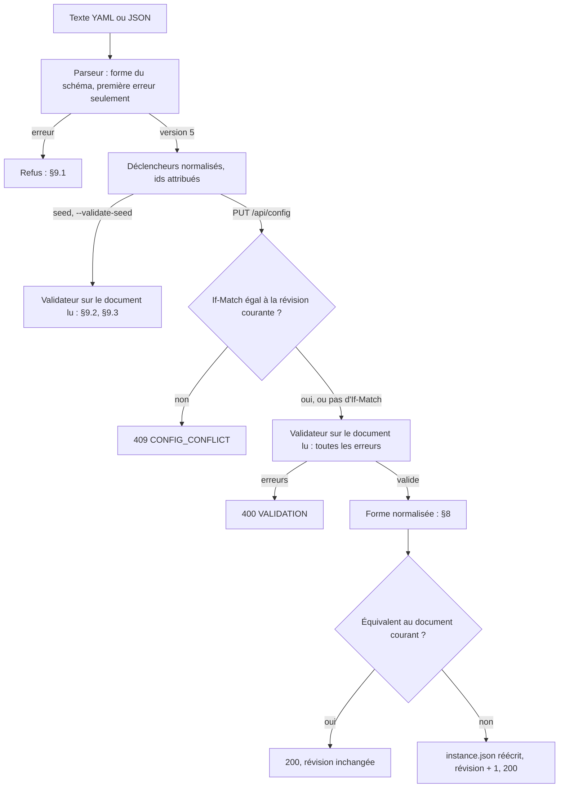

# Référence de la configuration (schéma version 24) et du plan

Ce document décrit, champ par champ, le document de configuration de Domia : le seed, le corps de `PUT /api/config`, la réponse de `GET /api/config`, la section `config` de `instance.json` et l'export YAML. Tous ont la même forme de configuration.

À côté de la config, `instance.json` porte un second document, le **plan** de la maison (murs, ouvertures, espaces, équipements) : même chemin (parseur strict, validateur, révision, `PUT` complet par la loop), sa propre révision, et aucun effet sur les lampes. Il est décrit au [§12](#12-le-plan-de-la-maison). Le plan ne connaît aucun objet de Domia : c'est la config qui dit où est chaque pièce, lampe, appareil et émetteur dans la 3D (`space`, `place`, §4.6).

- **Le code fait foi** : tout écart entre ce document et le code est un défaut, corrigé d'un côté ou de l'autre dans la même PR. Le code : les records de `backend/src/main/java/com/domia/domain/config/`, le validateur `ConfigValidator.java`, et le parseur `infra/seed/SeedParser.java`.
- **Le sens métier** des champs est dans [`domain.md`](domain.md) : [§3 les objets](domain.md#3-les-objets), §5 la loi, [§8 les actions](domain.md#8-les-actions), §10 le vocabulaire. Ce document donne les noms, les types, les défauts et les contraintes.

## 1. Comment le document est lu



Le parseur (`SeedParser`) transforme le texte en `Config`. Il vérifie la forme, pas la cohérence : c'est le rôle du validateur (§9).

| Règle | Détail |
|---|---|
| Format | YAML ou JSON. Pour un fichier : `.json` ⇒ JSON, toute autre extension ⇒ YAML. Pour l'API : selon `Content-Type`. |
| Noms de champs | `snake_case` (`ha_entity_id`, `vacant_after_sec`…). |
| Champ inconnu | Refusé : `UNKNOWN_KEY`. Aucun champ n'est ignoré. |
| Valeurs énumérées | Sensibles à la casse. `DAY` est accepté, `day` est refusé (`INVALID_VALUE`). Idem pour `kind` (`OCCUPANCY`, `LUX`), les clés de `situations` et `action` (`Toggle`, pas `toggle`). |
| Champ absent | Vaut `null`. Le validateur décide s'il est requis ; les accesseurs du code donnent les défauts (§4). |
| `trigger` | Normalisé avant validation : espaces retirés aux bords, minuscules (`" Single "` ⇒ `single`). |

### Version

| `version` du document | Ce qui se passe |
|---|---|
| `23` | Migrée en 24 (dans une instance) : les estimations (§15) et l'indice `IN_BED` du Coucher (§14) sont facultatifs, rien n'est réécrit. |
| `24` | Migrée en 25 dans une instance : la présence d'une personne (`presence`, `presence_quality`) devient sa première source (`presences`, §14.1). |
| `25` | Migrée en 26 dans une instance : seul le numéro change. |
| `26` | Migrée en 27 dans une instance : seul le numéro change. |
| `27` | Migrée en 28 dans une instance : `situation_authors` devient `situation_changes` (§14.2), chaque transition porte `mode` à la place d'`enabled`, le Départ `away_after_min` à la place de `gone_for_sec` (et perd `require_door`, `calm_for_sec`) ; une source de présence perd `quality` et `gone_after_sec` (§14.1) ; l'estimation `WHO_IS_HOME` disparaît (§15). |
| `28` | Lu tel quel. |
| un autre entier | Refusé par le parseur, avant la lecture stricte (`UNSUPPORTED_VERSION` sur `version`) : une ancienne forme donnerait sinon une clé inconnue trompeuse. Au seed, refus de démarrer (`SEED_INVALID`) ; avec `--validate-seed`, code de sortie 1 ; par `PUT /api/config`, `400 VALIDATION`. **Un seed d'une version plus ancienne se réécrit à la main** : de 27 à 28, `situation_authors` devient `situation_changes` (§14.2 : `mode` à la place d'`enabled`, `away_after_min` à la place de `gone_for_sec`, sans `require_door` ni `calm_for_sec` au Départ), une source de présence perd `quality` et `gone_after_sec` (§14.1), une estimation `WHO_IS_HOME` s'efface ; de 26 à 27, seul le numéro change (les gestes du brouillon d'un robot, §6.1, sont facultatifs) ; de 25 à 26, seul le numéro change (« qui est à la maison », `WHO_IS_HOME`, §15, est facultatif) ; de 24 à 25, la présence d'une personne, `presence` et `presence_quality`, devient `presences: [{ entity, quality }]` (§14.1) ; de 23 à 24, seul le numéro change (les estimations, §15, et l'indice `IN_BED`, §14, sont facultatifs) ; de 22 à 23, seul le numéro change (les personnes et les auteurs de situation, §14, l'entrée d'un contact, §4.4, et la chambre, §4.1, sont facultatifs) ; de 18 à 19, seul le numéro change (les émetteurs, §4.9, sont facultatifs) ; de 17 à 18, chaque association porte `target: { kind, id | ids }` (§6) ; de 16 à 17, `recipe` devient `translation` (§4.8) ; de 15 à 16, le numéro, et le `fan_speed: X` d'un programme devient `settings: { fan_speed: X }` (§4.8) ; de 14 à 15, seul le numéro change (la sœur « erreur » d'un robot, §4.8, et l'action `StartProgram`, §6, sont facultatives) ; de 13 à 14, seul le numéro change (la zone HA d'une pièce et les robots, §4.1 et §4.8, sont facultatifs) ; de 12 à 13, seul le numéro change (le bloc `notifications`, §13, est facultatif) ; de 11 à 12, seul le numéro change (les sortes `HUMIDITY` et `CO2`, et plusieurs capteurs d'une même sorte par pièce, §4.4) ; de 10 à 11, seul le numéro change (les règles d'un volet, §4.7, et le capteur `TEMPERATURE`, §4.4, sont facultatifs) ; de 9 à 10, seul le numéro change (les volets et les contacts, §4.4 et §4.7, sont facultatifs) ; de 8 à 9, seul le numéro change (les règles d'un appareil, §4.5, sont facultatives) ; de 7 à 8, seul le numéro change (les places, §4.6, sont facultatives) ; de 6 à 7, de 5 à 6, de 4 à 5 et de 3 à 4, seul le numéro change ; de 2 à 3, avec les règles du tableau de migration ci-dessous. |
| absente | Lue, puis refusée par le validateur (`UNSUPPORTED_VERSION`). |

Le fichier d'instance a son propre numéro, `schema_version` (actuellement **33**, `InstanceCodec.SCHEMA_VERSION`). Ne pas le confondre avec `version` (actuellement **27**, `ConfigValidator.SCHEMA_VERSION`). Au démarrage, un `schema_version` plus grand refuse le démarrage (`boot_failed reason=SCHEMA_TOO_NEW`) ; plus petit que 3 aussi (`reason=INSTANCE_UNREADABLE`), sans jamais écraser le fichier.

**Migrations en service : instance 3 → 4 → 5 → 6 → 7 → 8 → 9 → 10 → 11 → 12 → 13 → 14 → 15 → 16 → 17 → 18 → 19 → 20 → 21 → 22 → 23 → 24 → 25 → 26 → 27 → 28 → 29 → 30 → 31 → 32 → 33 → 34 → 35 (et sa config 2 → 3 → 4 → 5 → 6, inchangée de 7 à 9, puis 7, puis 8, puis 9, puis 10, puis 11, puis 12, puis 13, puis 14, puis 15, puis 16, puis 17, puis 18, puis 19, puis 20, puis 21, puis 22, puis 23, puis 24, puis 25, puis 26, puis 27, puis 28).** Une instance `schema_version: 3` à `34` est migrée au démarrage, étape par étape, par des fonctions pures (`InstanceMigrations`), testées sur de vrais fichiers (`backend/src/test/resources/instances/`). L'original est d'abord copié à côté, en `instance.json.v<n>.bak` (écrite atomiquement ; une copie identique est gardée, une copie tronquée ou périmée remplacée), puis la version 35 est écrite (`instance_migrated`). De 34 à 35, la config passe en 28 (`SituationChangesMigration.from34`) : `situation_authors` devient `situation_changes` ; dans chaque bloc de transition présent, `enabled: true` devient le mode allumé de la transition (`AUTO` pour `departure` et `arrival`, `PROPOSE` pour `bedtime` et `wake`), `enabled` faux ou absent devient `mode: OFF`, écrit en tête du bloc ; un bloc absent le reste et prend son défaut neuf (le Départ et le Retour changent alors seuls, §14.2) ; `gone_for_sec` devient `away_after_min` (arrondi à la minute, au moins 1), `require_door` et `departure.calm_for_sec` tombent ; chaque source de présence perd `quality` et `gone_after_sec` ; une estimation `WHO_IS_HOME` s'efface ; la situation du runtime : `proposed_by` devient `changed_by`. De 33 à 34, seuls les numéros changent : un appareil autorisé peut porter une sorte et une personne, et l'origine `ASSISTANT` existe (`ApiClientsMigration.from33`). De 32 à 33, seuls les numéros changent : la config passe en 27 (les gestes du brouillon d'un robot, `ToggleRoom`, `SetRecipe`, `LaunchDraft` et `ClearDraft`, §6.1, facultatifs ; le brouillon lui-même ne vit qu'en mémoire). De 31 à 32, seuls les numéros changent : la config passe en 26 (le modèle « qui est à la maison », `WHO_IS_HOME`, §15, facultatif ; aucune instance migrée n'en porte). De 30 à 31, la config passe en 25 : la présence de chaque personne, `presence` et `presence_quality`, devient sa première source, `presences: [{ entity, quality }]`, sans sorte ni délai (`via: OTHER`, `gone_after_sec: 0`) : le même comportement qu'avant (§14.1, `PresenceSourcesMigration`). De 29 à 30, seuls les numéros changent : la config passe en 24 (les estimations, §15, et l'indice `IN_BED` du Coucher, §14, facultatifs ; aucune instance migrée n'en porte). De 28 à 29, seuls les numéros changent : la config passe en 23 (les personnes et les auteurs de situation, §14, l'entrée d'un contact, §4.4, la chambre d'une pièce, §4.1, tous facultatifs) ; la situation du runtime peut porter `proposed_by`, l'auteur dont la proposition acceptée lui a donné sa valeur (aucune instance migrée n'en porte). De 27 à 28, seuls les numéros changent : la config passe en 22 (ce qu'est un appareil, `icon`, §4.5, facultatif). De 26 à 27, seuls les numéros changent : la config passe en 21 (l'éco en pièce vide et le rafraîchissement d'un émetteur, §4.9, facultatifs). De 25 à 26, la config passe en 20 (les deux délais du préchauffage d'un émetteur, §4.9, facultatifs) et la situation du runtime gagne `planned_end`, facultatif (absent : aucune fin prévue ; spec du climat §9). De 24 à 25, la config passe en 19 (les émetteurs, §4.9, facultatifs) et le runtime gagne `emitter_holds`, les Manuels des émetteurs (`[]`). De 23 à 24, la config ne change pas : l'instance gagne `api_clients: []`, les appareils autorisés à piloter la maison (`{ id, name, token_sha256, created_at }`, l'empreinte SHA-256 du jeton seulement ; ils se génèrent et se révoquent dans Réglages › API, jamais depuis un seed ni un export). De 22 à 23, la config passe en 18 : chaque association de bouton porte une seule cible, `target: { kind, id | ids }`, à la place des cinq champs `target_light_id`, `target_light_ids`, `target_room_id`, `target_appliance_id` et `target_machine_id` (§6) ; la sorte vient du champ qu'elle portait (une seule lampe devient `ids: [<id>]`, aucun champ devient `HOUSE`), le geste et ses options ne changent pas (`BindingTargetsMigration.from22`). De 21 à 22, la config passe en 17 : la traduction d'un robot change de nom, `recipe` devient `translation` (le même mot nommait la recette d'un programme), et gagne `room_order`, facultatif (§4.8) ; une mission en cours gagne `released: false` (`ProgramRecipes.from21`). De 20 à 21, la config passe en 16 (la recette d'un programme, ses recettes par pièce et la traduction d'un robot, §4.8, facultatives) et le `fan_speed` de chaque programme passe dans ses `settings` sous la cible `fan_speed` (`ProgramRecipes`) : le robot reçoit la même puissance, l'écran propose ensuite de la passer en recette. De 19 à 20, seuls les numéros changent : la config 15 ajoute la sœur « erreur » d'un robot (`show.error`, §4.8) et l'action `StartProgram` d'un bouton (`target_machine_id`, `action_payload.program_id`, §6). De 18 à 19, seul le numéro change : le runtime gagne `machines`, ce que Domia retient de chaque robot (absent = rien ; §4.8). De 17 à 18, seuls les numéros changent : la config 14 ajoute la zone HA d'une pièce (`ha_area`, §4.1) et les robots (`machines`, §4.8 ; absente = aucun). De 16 à 17, seuls les numéros changent : la config 13 ajoute le bloc `notifications` (§13 ; absent = aucun destinataire, rien ne part). De 15 à 16, seuls les numéros changent : la config 12 ajoute les sortes `HUMIDITY` et `CO2` et permet plusieurs capteurs d'une même sorte par pièce (§4.4). De 14 à 15, la config ne change pas ; chaque Manuel prend la forme générique `{ object_id, held, by, since, until, until_at }`, l'état tenu dans `held` (`{ on, brightness_pct }` pour une lampe, `{ on }` pour un appareil, `{ position, tilt }` pour un volet), et `runtime.holds` devient `runtime.light_holds` (spec [`2026-10-19-domia-contrat-commun-design.md`](superpowers/specs/2026-10-19-domia-contrat-commun-design.md) §4). De 13 à 14, la config passe en 11 (les règles d'un volet, §4.7, toutes facultatives, et le capteur `TEMPERATURE`, §4.4) et le runtime gagne `cover_holds`, les Manuels des volets (`[]`). De 12 à 13, seuls les numéros changent : la config 10 ajoute les volets (`covers`, §4.7 ; absente = aucun) et le capteur `CONTACT` (§4.4). De 11 à 12, la config passe en 9 (les règles d'un appareil, §4.5, toutes facultatives) et le runtime gagne deux champs : `situation.since`, l'instant où la situation a pris sa valeur (posé à son `updated_at`), et `appliance_holds`, les Manuels des appareils (`[]`). De 10 à 11, les liens du plan deviennent les places de la config (`LinksToPlaces`) : chaque espace `room: R` dont la pièce existe donne `space` à la pièce `R` ; chaque objet `LIGHT` dont la lampe existe lui donne `place` (`at`, `model`, `size`, `rotation`) ; chaque `APPLIANCE` dont l'appareil existe, `place.at`. Les liens vers un objet disparu sont abandonnés, nommés par `instance_migrated dropped_links=spaces.<id>,objects.<id>` ; la sauvegarde les garde. Le plan passe en version 4 (sans liens, §12.6), la config en 8. De 9 à 10, seuls les numéros changent : la config 7 ajoute les appareils (`appliances`, §4.5 ; absente = aucun) et `target_appliance_id` (§6), le plan passe en version 3 (la sorte `APPLIANCE`, §12.3). De 8 à 9, le plan de l'instance passe en version 2 (`plan_version: 2` : des modèles de plus au catalogue, aucun retiré, §12.6) ; rien d'autre ne change, et une instance sans plan ne change que de numéro. De 7 à 8, le plan de la maison entre dans l'instance, vide : la clé `plan` reste absente (pas de plan) et `meta.plan_revision` vaut 0 ; la config ne change pas (§12.5). De 6 à 7, seuls les numéros changent : la config 6 ajoute l'action `Dim` (la rotation d'une molette) et ses deux réglages optionnels (§6.1). De 5 à 6, seuls les numéros changent : la config 5 ajoute deux champs optionnels par lampe (`restore_on_return`, `restore_within_sec`, §4.2) et l'instance ses intentions de retour (`runtime.restores`, absent = aucune). De 4 à 5 aussi : la config 4 ajoute un champ optionnel (`target_light_ids`, §6). De 3 à 4 :

| Avant | Après |
|---|---|
| lampe : `override_release_after_sec` | pièce : `depart_after_sec` = le plus grand délai de ses lampes (le comportement d'un override « allumée » est gardé) |
| lampe : `restore_on_return`, `restore_within_sec` | supprimés (ils reviennent en config 5, désactivés par défaut) |
| override `until: VACANCY` | Manuel `until: DEPARTURE`, sans niveau (allumage seul) |
| override `until: MANUAL` (pause) | Manuel `until: NEVER` |
| intentions de retour | supprimées (comptées dans le log) |

Revenir à une version antérieure de Domia exige de remettre la sauvegarde (`runbook-prod.md`).

## 2. Racine du document

| Champ | Type | Obligatoire | Défaut | Contraintes du validateur |
|---|---|---|---|---|
| `version` | entier | oui | — | doit valoir `6` (`UNSUPPORTED_VERSION`) |
| `house` | objet (§3) | oui | — | — |
| `rooms` | liste de pièces (§4.1) | oui | — | au moins une pièce (`REQUIRED`) |
| `buttons` | liste de boutons (§5) | non | `[]` | — |
| `bindings` | liste d'associations (§6) | non | `[]` | — |
| `notifications` | objet (§13) | non | aucun destinataire | — |
| `people` | liste de personnes (§14) | non | `[]` | — |
| `situation_changes` | objet (§14.2) | non | ses défauts : le Départ et le Retour changent seuls, le Coucher propose, le Réveil dort | — |
| `estimates` | liste d'estimations (§15) | non | `[]` | — |

## 3. `house` — la maison

| Champ | Type | Obligatoire | Défaut | Contraintes du validateur |
|---|---|---|---|---|
| `name` | texte | oui | — | — |
| `timezone` | texte | oui | — | un fuseau IANA, comme `Europe/Zurich` (`INVALID_VALUE`) ; informatif, aucune loi ne le lit |
| `situation_default` | `DAY` \| `NIGHT` \| `AWAY` | oui | — | lu seulement à l'amorce |

## 4. Pièces et lampes

### 4.1 `rooms[]` — la pièce
| Champ | Type | Obligatoire | Défaut | Contraintes du validateur |
|---|---|---|---|---|
| `id` | identifiant (§7) | non (attribué) | `room_<8 hex>` | `INVALID_ID`, `DUPLICATE_ID` (unique parmi les pièces) |
| `name` | texte | oui | — | — |
| `vacant_after_sec` | entier (secondes) | oui | — | `≥ 0` (`OUT_OF_RANGE`). Délai sans présence (après le dernier « off » du capteur) avant que la pièce soit vide : ses lampes s'éteignent alors, après leur préavis (domain.md §7) |
| `depart_after_sec` | entier (secondes) | non | `600` (`Room.DEFAULT_DEPART_AFTER_SEC`) | `≥ 60` (`OUT_OF_RANGE`, `ConfigValidator.MIN_DELAY_SEC`). Pièce vide depuis ce délai : les lampes en Manuel repassent en Auto (domain.md §6) |
| `lights` | liste de lampes (§4.2) | oui | — | la liste peut être vide |
| `sensors` | liste de capteurs (§4.4) | non | `[]` | plusieurs capteurs d'une même sorte se combinent (§4.4) ; sans `OCCUPANCY` ⇒ avertissement `NO_OCCUPANCY_SENSOR` |
| `appliances` | liste d'appareils (§4.5) | non | `[]` | — |
| `covers` | liste de volets (§4.7) | non | `[]` | — |
| `emitters` | liste d'émetteurs (§4.9) | non | `[]` | — |
| `ha_area` | id d'une zone de HA | non | absent : un robot ne sait pas nettoyer cette pièce seule | forme d'un id (`INVALID_ID`) ; deux pièces ne désignent pas la même zone (`DUPLICATE_AREA`). L'existence de la zone dans HA n'est pas jugée. C'est par elle qu'un robot nettoie la pièce (`vacuum.clean_area`, §4.8) |
| `machines` | liste de robots (§4.8) | non | `[]` | — |
| `bedroom` | booléen | non | `false` | une chambre : on y dort (spec de la situation proposée §4) ; lue par les auteurs du coucher, aucune loi ne la lit encore |
| `space` | id d'un espace du plan (§12.3) | non | absent : la pièce n'est pas dans la 3D | forme d'un id (`INVALID_ID`) ; deux pièces ne désignent pas le même espace (`DUPLICATE_SPACE`). L'existence de l'espace n'est **pas** jugée (§4.6) |

### 4.2 `rooms[].lights[]` — la lampe
| Champ | Type | Obligatoire | Défaut | Contraintes du validateur |
|---|---|---|---|---|
| `id` | identifiant (§7) | non (attribué) | `light_<8 hex>` | `INVALID_ID`, `DUPLICATE_ID` (unique parmi les lampes) |
| `name` | texte | non | — | — |
| `ha_entity_id` | texte | oui | — | préfixe `light.` ou `switch.` suivi d'au moins un caractère (`INVALID_PREFIX`) ; unique toutes entités confondues (`DUPLICATE_ENTITY`) |
| `dimmable` | booléen | oui | — | — |
| `dark_below_lux` | nombre (lux) | non | absent | interdit si la pièce n'a pas de capteur `LUX` (`NO_LUX_SENSOR`) ; `≥ 0` (`OUT_OF_RANGE`) |
| `auto_off` | booléen | non | `true` (`Light.autoOffOrDefault`) | — |
| `off_warning_sec` | entier (secondes) | non | `60` (`Light.DEFAULT_OFF_WARNING_SEC`) | `0` (pas de préavis) ou entre `10` et `600` (`OUT_OF_RANGE`). Préavis avant une extinction automatique (domain.md §7) : la lampe baisse de moitié pendant ce délai, un retour de présence l'annule. Sans effet sur une lampe non dimmable |
| `restore_on_return` | booléen | non | `false` (`Light.restoreOnReturnOrDefault`) | Éteinte au départ si elle était gardée allumée, rallumée au retour telle qu'on l'avait laissée (domain.md §7). Le « restore » du Lab |
| `restore_within_sec` | entier (secondes) | non | `1800` = 30 min (`Light.DEFAULT_RESTORE_WITHIN_SEC`) | entre `60` et `86400` (`OUT_OF_RANGE`). Combien de temps après le départ le retour vaut encore |
| `situations` | objet `{ DAY?, NIGHT?, AWAY? }` (§4.3) | non | voir §4.3 | une clé sans valeur (`DAY:`) donne `INVALID_TYPE`, au seed comme par `PUT` (§8) ; `DAY: {}` est accepté, tous défauts |
| `place` | objet `{ at, model, size?, rotation? }` (§4.6) | non | absent : la lampe n'est pas dans la 3D | voir §4.6 |

Le validateur ne relie pas `dimmable` au préfixe : `dimmable: true` sur un `switch.*` est accepté. À l'envoi, `brightness_pct` n'est ajouté que pour une entité `light.*` dimmable (`engine/Dispatch.send`).

### 4.3 `situations.<S>` — la règle d'une situation
`<S>` vaut `DAY`, `NIGHT` ou `AWAY`. Chaque clé est facultative. Une clé absente, ou un champ absent dans une règle, prend son défaut (`SituationRule.defaultFor`, `Light.situationsOrDefault`).

| Champ | Type | Obligatoire | Défaut | Contraintes du validateur |
|---|---|---|---|---|
| `auto_on` | booléen | non | `DAY` : `true` · `NIGHT` : `true` · `AWAY` : `false` | — |
| `brightness` | entier 1–100 | non | absent | entre 1 et 100 (`OUT_OF_RANGE`) ; lampe dimmable seulement (`NOT_DIMMABLE`) ; avec `auto_on` faux ⇒ avertissement `BRIGHTNESS_WITHOUT_AUTO_ON` |

### 4.3.1 Les comportements, tels que les Réglages les écrivent
L'écran ne montre pas `auto_off` et `auto_on` champ par champ : il propose quatre comportements (`frontend/src/screens/Config/behavior.ts`, navigation §3). Il lit les champs absents par leurs défauts (§4.2, §4.3) et n'écrit que ceux du tableau.

| Comportement | `auto_off` | `situations.<S>.auto_on` | Les niveaux (`brightness`) |
|---|---|---|---|
| Automatique | `true` | vrai pour au moins un mode ; venant d'un état sans aucun allumage seul, `DAY` et `NIGHT` à `true` (les défauts), sinon les modes déjà choisis restent | gardés |
| Ambiance | `false` | idem | gardés |
| S'éteint seule | `true` | `false` dans les trois modes | gardés |
| À la main seulement | `false` | `false` dans les trois modes | retirés (`null`) : un niveau ferait recaler la lampe (domain.md §5, règle 2) |

Une lampe sans allumage seul ni extinction seule, mais avec un niveau, s'affiche « Personnalisé » : aucun des quatre n'est coché, et en choisir un la remet dans une case. Couper « Luminosité réglable » (`dimmable: false`) retire aussi les niveaux de chaque mode (`NOT_DIMMABLE` sinon), et l'écran dit quels appuis `SetBrightness` ou `Dim` la visent encore. Le seuil de sombre (`dark_below_lux`) s'y règle en « Plus tôt » ou « Plus tard », par paliers de 5, 10, 20, 40, 80 et 150 lx ; « Sans seuil » le retire.

### 4.4 `rooms[].sensors[]` — le capteur
| Champ | Type | Obligatoire | Défaut | Contraintes du validateur |
|---|---|---|---|---|
| `id` | identifiant (§7) | non (attribué) | `sensor_<8 hex>` | `INVALID_ID`, `DUPLICATE_ID` (unique parmi les capteurs) |
| `name` | texte | non | — | — |
| `kind` | `OCCUPANCY` \| `LUX` \| `CONTACT` \| `TEMPERATURE` \| `HUMIDITY` \| `CO2` | oui | — | autant de capteurs d'une sorte qu'on veut : ils se combinent (ci-dessous) |
| `ha_entity_id` | texte | oui | — | préfixe `binary_sensor.` pour `OCCUPANCY` et `CONTACT`, `sensor.` pour les mesures `LUX`, `TEMPERATURE`, `HUMIDITY` et `CO2` (`INVALID_PREFIX`) ; unique toutes entités confondues (`DUPLICATE_ENTITY`) |
| `opening` | id d'une ouverture du plan (§12.3) | non | absent | l'ouverture que surveille un contact ; `CONTACT` seulement (`FORBIDDEN`) ; forme d'un id (`INVALID_ID`). Son existence n'est pas jugée (§4.6) |
| `entrance` | booléen | non | `false` | une porte d'entrée de la maison : sa fermeture date un départ, son ouverture une arrivée (§14.3) ; `CONTACT` seulement (`FORBIDDEN`) |

Un contact (`CONTACT`) dit si une porte ou une fenêtre est ouverte (`on`) ou fermée (`off`) ; la loi des volets ne descend jamais un volet dont l'ouverture est ouverte, ou dont le contact est injoignable (§4.7). Un capteur de température (`TEMPERATURE`, en °C, de classe `temperature` dans HA) n'est lu que par la protection solaire des volets de sa pièce (`protect_above_c`).

Une humidité (`HUMIDITY`, en %, classe `humidity`) et un CO2 (`CO2`, en ppm, classe `carbon_dioxide`) ne sont lus par aucune loi : ils se montrent sur la carte et l'écran de la pièce, et dans la page « Capteurs » des Réglages. Plusieurs capteurs d'une même sorte dans une pièce se combinent (spec [`2026-10-19-domia-faits-design.md`](superpowers/specs/2026-10-19-domia-faits-design.md) §4) : présence, quelqu'un si l'un d'eux voit quelqu'un (inconnue si l'un n'a jamais répondu, sinon vide depuis la dernière extinction) ; luminosité, la plus faible (la dernière valeur valide de chacun) ; température et humidité, la moyenne des valeurs valides ; CO2, la plus haute ; une ouverture, ouverte si l'un de ses contacts dit « ouvert » ou ne répond pas. Un capteur qui ne répond pas sort du calcul ; si aucun ne répond, la mesure est inconnue.

### 4.5 `rooms[].appliances[]` — l'appareil
Ce que Domia allume et éteint et qui n'éclaire pas ; sa loi, s'il a des règles, n'éteint que ce qui était déjà allumé quand la condition a commencé, et « Garder allumé » la suspend ([domain.md §3](domain.md#3-les-objets)). Sans règle, rien ne l'éteint seul.

| Champ | Type | Obligatoire | Défaut | Contraintes du validateur |
|---|---|---|---|---|
| `id` | identifiant (§7) | non (attribué) | `appliance_<8 hex>` | `INVALID_ID`, `DUPLICATE_ID` (unique parmi les appareils) |
| `name` | texte | oui | — | `REQUIRED` |
| `ha_entity_id` | texte | oui | — | préfixe `switch.` ou `light.` (`INVALID_PREFIX`) ; unique toutes entités confondues (`DUPLICATE_ENTITY`) : une prise est une lampe ou un appareil, jamais les deux |
| `icon` | énumération | non | absent : `PLUG` | ce qu'il est, pour son icône (tuile, fiche, pastille de la 3D) : `TV`, `COMPUTER`, `ROUTER`, `CONSOLE`, `SPEAKER`, `WASHER`, `COFFEE`, `FAN`, `PLUG` ; une autre valeur : `INVALID_VALUE` |
| `never_off` | booléen | non | `false` | Domia refuse de l'éteindre (`APPLIANCE_NEVER_OFF`) |
| `power_sensor` | texte | non | absent | préfixe `sensor.` (`INVALID_PREFIX`) ; unique toutes entités confondues (`DUPLICATE_ENTITY`) ; sa valeur en `W` ou `kW` |
| `standby_below_w` | nombre (watts) | non | absent : jamais en veille | `> 0` (`OUT_OF_RANGE`) ; demande `power_sensor` (`REQUIRED` sur `power_sensor`) |
| `standby_off_after_sec` | entier (s) | non | absent : jamais | AP2, éteint après ce temps en veille ; entre 60 et 86400 (`OUT_OF_RANGE`) ; demande `standby_below_w` (`REQUIRED` sur `standby_below_w`) ; interdit avec `never_off` (`FORBIDDEN`) |
| `auto_off` | booléen | non | `false` | AP3, éteint au départ confirmé de la pièce s'il était allumé quand elle s'est vidée ; sans capteur de présence, sans effet (l'avertissement `NO_OCCUPANCY_SENSOR` le dit) ; interdit avec `never_off` (`FORBIDDEN`) |
| `situations.<S>.turn_off` | booléen | non | `false` | AP1, éteint en entrant dans `S` s'il était allumé avant ; `S` parmi `DAY`, `NIGHT`, `AWAY` ; aucune autre clé dans la règle (`UNKNOWN_KEY` à la lecture) ; `situations.<S>` sans valeur : `INVALID_TYPE` ; `true` interdit avec `never_off` (`FORBIDDEN`) |
| `place` | objet `{ at }` (§4.6) | non | absent : l'appareil n'est pas dans la 3D | voir §4.6 |

```yaml
    appliances:
      - { id: office_pc, name: Bureau (PC), ha_entity_id: switch.prise_bureau, power_sensor: sensor.prise_bureau_power, standby_below_w: 10 }
      - id: living_tv                   # la prise du meuble TV : éteinte en Absent et la nuit, et après 30 min de veille
        name: Meuble TV
        ha_entity_id: switch.prise_tv
        power_sensor: sensor.prise_tv_power
        standby_below_w: 10
        standby_off_after_sec: 1800
        situations: { NIGHT: { turn_off: true }, AWAY: { turn_off: true } }
```

### 4.6 `space` et `place` — la place dans la 3D
Où la 3D dessine l'objet ([domain.md §3](domain.md#3-les-objets)). Le plan (§12) ne décrit que la maison physique : c'est l'objet qui porte sa place, réglée dans la 3D en mode « Arranger » (`frontend/README.md`) et écrite par `PUT /api/config`, comme tout réglage. Mètres et degrés, dans le repère du plan (§12.3).

| Champ | Type | Obligatoire | Défaut | Contraintes du validateur |
|---|---|---|---|---|
| `place.at` | `[x, y, z]` | oui, avec `place` | — | `REQUIRED` ; trois nombres finis (`INVALID_VALUE`). Une lampe : le centre de son emprise au sol, `z` sa base (comme un objet du plan) ; un appareil : le point de sa pastille |
| `place.model` | un modèle de lampe (ci-dessous) | oui, pour une lampe | — | `REQUIRED` ; une valeur hors catalogue est refusée par le parseur (`INVALID_VALUE`) ; interdit pour un appareil (`FORBIDDEN`) |
| `place.size` | `[l, p, h]` (m) | non | la taille du modèle | trois nombres `> 0` (`INVALID_VALUE`, `OUT_OF_RANGE`) ; interdit pour un appareil (`FORBIDDEN`) |
| `place.rotation` | degrés, sens antihoraire vu de dessus | non | `0` | interdit pour un appareil (`FORBIDDEN`) |

Les modèles de lampe (`LampModel`, et le contrat du catalogue, `lamp_models`), avec leur taille par défaut `[l, p, h]` en mètres : `PENDANT_BAR` (une suspension en barre, `h` la longueur de ses câbles ; `[1.2, 0.04, 0.84]`), `CEILING_ROUND` (un plafonnier rond ; `[0.4, 0.4, 0.08]`), `CEILING_RING` (un anneau plat ; `[0.45, 0.45, 0.08]`), `MUSHROOM_LAMP` (`[0.3, 0.3, 0.38]`), `GLOBE_LAMP` (`[0.25, 0.25, 0.25]`), `PROJECTOR_LAMP` (`[0.12, 0.12, 0.3]`), `LED_STRIP` (un ruban, `l` sa longueur ; `[1.0, 0.03, 0.01]`). Les trois premiers se posent au plafond de leur espace. Un appareil n'a ni modèle ni taille : il n'a pas de corps 3D.

```yaml
  - id: office
    name: Bureau
    space: s_jardin
    lights:
      - { id: office_ceiling, name: Plafonnier, ha_entity_id: light.bureau, dimmable: true,
          place: { at: [1.7, 13.3, 2.44], model: CEILING_RING, size: [0.6, 0.6, 0.05] } }
    appliances:
      - { id: office_pc, name: Bureau (PC), ha_entity_id: switch.prise_bureau, place: { at: [3.25, 12.17, 0.5] } }
```

**Ce que la config ne juge pas** : elle est validée sans le plan. Un `space` qui ne nomme aucun espace du plan, ou une place hors de tout espace, ne sont pas des erreurs ; `GET /api/plan` les calcule à chaque lecture (`places`, §12.4) et la 3D et les Vérifications des Réglages les signalent. Supprimer ou renommer un espace dans le plan n'est jamais bloqué par la config. Il en va de même de l'`opening` d'un volet ou d'un contact (§4.7) : une ouverture absente du plan donne `UNKNOWN_OPENING` à la lecture (§12.4).

### 4.7 `rooms[].covers[]` — le volet
Un volet, un store ou une fenêtre de toit motorisée : une entité `cover.*` de HA ([domain.md §3](domain.md#3-les-objets)). Ce qu'il sait faire (aller à une position, s'arrêter, incliner ses lamelles) se lit dans HA (`supported_features`), ne se déclare pas. Sa loi (OU1 à OU4, [domain.md §3](domain.md#3-les-objets)) : quatre règles facultatives, aucune par défaut ; sans aucune, il ne bouge que sur une commande. Les actions de pièce ne le voient jamais.

| Champ | Type | Obligatoire | Défaut | Contraintes du validateur |
|---|---|---|---|---|
| `id` | identifiant (§7) | non (attribué) | `cover_<8 hex>` | `INVALID_ID`, `DUPLICATE_ID` (unique parmi les volets) |
| `name` | texte | oui | — | `REQUIRED` |
| `ha_entity_id` | texte | oui | — | préfixe `cover.` (`INVALID_PREFIX`) ; unique toutes entités confondues (`DUPLICATE_ENTITY`) |
| `opening` | id d'une ouverture du plan (§12.3) | non | absent : le volet n'est pas dans la 3D | forme d'un id (`INVALID_ID`). Son existence n'est pas jugée (§4.6) |
| `travel_sec` | entier (s) | non | `60` (`Cover.DEFAULT_TRAVEL_SEC`) | la durée d'une course complète, l'attente de l'écho d'une commande ; entre 10 et 300 (`OUT_OF_RANGE`) |
| `close_at_night` | booléen | non | `false` | OU1 : fermé (0) quand le soleil est couché ; demande un `site` dans le plan pour agir |
| `sun_protection` | booléen | non | `false` | OU2 : abrité quand le soleil donne sur la façade de `opening` depuis 10 min, en Absent ou au-dessus de `protect_above_c` ; demande un `site` et une ouverture connue du plan pour agir |
| `sun_position` | entier (%) | non | `20` (`Cover.DEFAULT_SUN_POSITION`) | la position de OU2 ; entre 0 et 100 (`OUT_OF_RANGE`) ; seulement avec `sun_protection: true` (`FORBIDDEN`) |
| `protect_above_c` | nombre (°C) | non | `25` (`Cover.DEFAULT_PROTECT_ABOVE_C`) | le seuil de OU2 avec un capteur `TEMPERATURE` dans la pièce ; entre 15 et 40 (`OUT_OF_RANGE`) ; seulement avec `sun_protection: true` (`FORBIDDEN`) |
| `situations.<S>.position` | entier (%) | non | absent | OU3 : la position dans la situation `S`, `NIGHT` ou `AWAY` (`DAY` : `FORBIDDEN`, c'est `open_by_day` qui décide) ; entre 0 et 100 (`OUT_OF_RANGE`) ; `position` requise (`REQUIRED`) |
| `open_by_day` | booléen | non | `false` | OU4 : ouvert (100) en Jour, soleil levé ; demande un `site` dans le plan pour agir |
| `min_move_interval_sec` | entier (s) | non | `900` (`Cover.DEFAULT_MIN_MOVE_INTERVAL_SEC`) | la loi le bouge au plus une fois par ce délai ; entre 60 et 7200 (`OUT_OF_RANGE`) |

```yaml
    sensors:
      - { id: living_bay_contact, name: Contact baie, kind: CONTACT, ha_entity_id: binary_sensor.salon_baie_contact, opening: o_baie_sejour }
    covers:
      - id: living_bay
        name: Baie
        ha_entity_id: cover.salon_baie
        opening: o_baie_sejour
        travel_sec: 40
        close_at_night: true                # OU1
        sun_protection: true                # OU2, à 20 % par défaut
        open_by_day: true                   # OU4
      - id: bedroom_window
        name: Fenêtre
        ha_entity_id: cover.chambre_fenetre
        close_at_night: true
        situations: { NIGHT: { position: 0 } }   # OU3 : fermée toute la Nuit, même au lever du soleil
        open_by_day: true
```

### 4.8 `rooms[].machines[]` — le robot

Un robot aspirateur ou laveur : une entité `vacuum.*` de HA ([domain.md §3](domain.md#3-les-objets)), déclarée dans la pièce de sa base. Ce qu'il sait faire (démarrer, pause, arrêt, retour, puissance, localiser, nettoyer une zone) se lit dans HA (`supported_features`), ne se déclare pas. Domia ne parle au robot que par les services standard de HA, jamais par une commande propre à une marque : une pièce se nettoie par sa zone HA (`ha_area`, §4.1, avec `vacuum.clean_area`). Le lien entre les pièces du robot et les zones se fait dans HA, sur l'entité du robot ([`installation.md`](installation.md) §1).

| Champ | Type | Obligatoire | Défaut | Contraintes du validateur |
|---|---|---|---|---|
| `id` | identifiant (§7) | non (attribué) | `machine_<8 hex>` | `INVALID_ID`, `DUPLICATE_ID` (unique parmi les robots) |
| `name` | texte | oui | — | `REQUIRED` |
| `ha_entity_id` | texte | oui | — | préfixe `vacuum.` (`INVALID_PREFIX`) ; unique toutes entités confondues (`DUPLICATE_ENTITY`) |
| `translation` | traduction (ci-dessous) | non | absente : aucune question de recette, aucun rang | comment ce robot comprend la recette d'un programme, et le rang de ses pièces (`room_order`) |
| `programs[]` | liste de programmes | non | `[]` | voir ci-dessous |
| `situations.AWAY.program` | id d'un programme | non | absent : la loi ne le lance jamais | seule `AWAY` est permise (`FORBIDDEN`) ; `program` requis (`REQUIRED`) et connu (`UNKNOWN_REFERENCE`). Sans elle, le robot n'est pas piloté : il ne part que sur un geste |
| `min_interval_sec` | entier (s) | non | `86400` (`Machine.DEFAULT_MIN_INTERVAL_SEC`) | la loi ne repart pas avant ce délai depuis la dernière mission réussie ; entre 3600 et 604800 (`OUT_OF_RANGE`) |
| `start_after_sec` | entier (s) | non | `300` (`Machine.DEFAULT_START_AFTER_SEC`) | la loi part après ce délai en Absent ; entre 0 et 3600 (`OUT_OF_RANGE`) |
| `show.sensors` | liste d'entités | non | `[]` | ce que la fiche montre (brosses, filtre, bac…) : `sensor.` ou `binary_sensor.` (`INVALID_PREFIX`) |
| `show.buttons` | liste d'entités | non | `[]` | les actions de la base que la fiche propose (vider, laver…) : `button.` (`INVALID_PREFIX`). Domia n'appuie que sur celles-là |
| `show.current_room` | entité | non | absent | le capteur qui nomme la pièce où passe le robot : `sensor.` (`INVALID_PREFIX`) |
| `show.map` | entité | non | absent | la carte du robot : `image.` ou `camera.` (`INVALID_PREFIX`). Son image passe par Domia (`GET /api/machines/{id}/map`) ; si elle porte `vacuum_position`, `charger_position` et `rooms` (la convention de la carte Xiaomi : Dreame, Roborock, Valetudo), Domia en tire la pièce en cours, la trace de la mission et la position du robot dans la 3D |
| `show.error` | entité | non | absent | le capteur qui dit pourquoi le robot est bloqué : `sensor.` (`INVALID_PREFIX`). Montré sur la fiche et dans la notification `MACHINE_STUCK` |
| `place` | place (§4.6) | non | absent : la base n'est pas dans la 3D | un point seul, comme un appareil |

**La recette et sa traduction** (spec [`2026-10-20-domia-robots-recettes-design.md`](superpowers/specs/2026-10-20-domia-robots-recettes-design.md)) : un programme dit ce qu'il veut en quatre questions communes à tous les robots ; chaque robot dit une fois, dans `translation`, comment il les comprend.

| Question | Choix |
|---|---|
| `what` (Quoi) | `VACUUM` Aspirer · `MOP` Laver · `BOTH` Les deux · `AUTO` Intelligent (le robot règle seul le reste : CleanGenius, SmartPlan…) |
| `suction` (Aspiration) | `QUIET` · `NORMAL` · `STRONG` · `MAX` |
| `water` (Eau) | `LOW` · `MEDIUM` · `HIGH` ; sans objet avec `VACUUM` |
| `passes` (Passages) | `1` · `2` |

La traduction `translation` d'un robot donne, par question et par choix, les réglages à poser : une table cible ⇒ valeur, dans l'ordre où ils se posent. Une cible est une sœur `select.` (une option) ou `number.` (un nombre, `INVALID_VALUE`) (`INVALID_PREFIX`), ou le mot `fan_speed` (la puissance standard, `vacuum.set_fan_speed`). Un choix hors de la liste : `UNKNOWN_CHOICE` ; un choix sans réglage : `REQUIRED`. Une question ou un choix absent n'apparaît pas à l'écran.

`translation.room_order` (spec [`2026-10-20-domia-robots-ordre-design.md`](superpowers/specs/2026-10-20-domia-robots-ordre-design.md)) : pour un robot qui suit l'ordre des pièces de sa carte plutôt que celui de la liste qu'on lui envoie (Dreame), une pièce de Domia ⇒ le `select` de son rang sur la carte (options `"1"` … `"n"`). Une pièce inconnue : `UNKNOWN_REFERENCE` ; une valeur vide : `REQUIRED` ; une entité qui n'est pas un `select.` : `INVALID_PREFIX` ; deux pièces sur la même entité : `DUPLICATE_ENTITY`. Absent : le robot reçoit les zones dans l'ordre du programme, sans rang posé. Réglages › Machines › le robot › « Lien avec Home Assistant » › « Lire le robot » propose la traduction, les rangs et ce que la fiche montre en lisant les sœurs du robot.

Un programme (`programs[]`) prépare une mission :

| Champ | Type | Obligatoire | Défaut | Contraintes du validateur |
|---|---|---|---|---|
| `id` | identifiant (§7) | non (attribué) | `program_<8 hex>` | `INVALID_ID`, `DUPLICATE_ID` (unique dans le robot) |
| `name` | texte | oui | — | `REQUIRED` |
| `rooms` | liste d'ids de pièces, dans l'ordre de passage | non | `[]` : toute la maison (`vacuum.start`) | pièce connue (`UNKNOWN_REFERENCE`), pas deux fois (`INVALID_VALUE`), avec une zone HA (`NO_AREA`, sauf avec `script`) |
| `recipe` | `{ what, suction, water, passes }` | non | absent : le robot garde ses réglages | chaque question facultative ; un choix que la traduction du robot n'a pas : `UNTRANSLATED` ; `passes` 1 ou 2 (`OUT_OF_RANGE`) ; avec `what: AUTO` seul `what` se pose, avec `VACUUM` l'eau ne se pose pas ; interdite avec `script` (`FORBIDDEN`) |
| `by_room` | table pièce ⇒ recette | non | `{}` | la recette propre d'une pièce : pour une pièce du programme, les réponses qui changent, le reste vient de `recipe` ; une pièce absente des `rooms` : `UNKNOWN_REFERENCE` ; sans pièces (toute la maison) ou avec `script` : `FORBIDDEN` ; chaque recette d'une pièce traduite comme `recipe` (`UNTRANSLATED`, `OUT_OF_RANGE`) |
| `settings` | table cible ⇒ valeur | non | `{}` | « Avancé » : des réglages bruts posés après la recette, par ordre de cible, la puissance (`fan_speed`) en dernier : `select.`, `number.` ou `fan_speed`, comme une traduction ; valeur requise (`REQUIRED`) ; interdits avec `script` (`FORBIDDEN`) |
| `script` | entité | non | absent : Domia lance la mission | un `script.` de HA qui fait tout (`INVALID_PREFIX`), pour un robot sans `clean_area` ; ses pièces sont seulement déclarées |

Les pièces voisines de même recette font une étape, dans l'ordre du programme (une pièce d'une autre recette entre deux coupe l'étape : l'ordre voulu prime sur le nombre de retours à la base) : une seule étape le plus souvent ; plusieurs font une **mission en étapes** (spec des recettes §6) : Domia lance la première, attend que le robot revienne (`docked` depuis 2 min, le temps d'une recharge en cours d'étape, ou `idle`), puis lance la suivante avec sa recette ; c'est une seule mission (un Manuel, une réussite), dont la vue dit `mission.steps` (les pièces de chaque étape) et `mission.step` (celle en cours, de 0). Un retour à la base, un arrêt, une panne ou une étape refusée arrêtent toute la mission ; un redémarrage de Domia finit l'étape en cours, sans les suivantes. Pour chaque étape, Domia envoie les réglages de la recette (Quoi, Aspiration, Eau, Passages ; une cible posée deux fois garde la dernière valeur), puis ceux d'Avancé, puis, si l'étape a au moins deux pièces, le rang de celles qui en ont un (`select.select_option`, `"1"`, `"2"`… dans l'ordre du programme), puis `vacuum.clean_area` avec les zones des pièces dans l'ordre du programme (ou `vacuum.start`, ou le script), chaque étape seulement quand la précédente a réussi : un réglage refusé arrête tout, le robot ne part pas à moitié réglé, et la fiche nomme l'entité refusée. Le rang posé reste sur la carte du robot.

**La loi des missions** ([domain.md](domain.md#3-les-objets), spec des robots §7) : en Absent depuis `start_after_sec`, un robot à sa base, sans mission, part une fois par absence avec `situations.AWAY.program`, sans les pièces occupées (une pièce sans capteur de présence compte comme vide ; un programme « toute la maison » ou confié à un script attend que toutes ses pièces soient vides), si sa dernière mission réussie date de plus de `min_interval_sec`. Quand on revient (Jour ou Nuit), la loi renvoie à sa base la mission qu'elle a lancée. Une mission lancée ailleurs (l'app de la marque, son horaire) ou à la main dans Domia est tenue : la loi n'y touche pas, jusqu'au geste `Release`.

Ce que Domia retient d'un robot vit dans l'instance, `runtime.machines` (jamais dans la config, jamais l'état de l'appareil) : `{ machine_id, mission: { by, program, rooms, started_at, failed, recalled, released, error_since }, last_success: { at, program, rooms }, law_started_at }`, chaque champ absent quand il n'y a rien. `by` vaut `LAW`, `DOMIA` ou `ELSEWHERE` et ne change jamais ; `released` dit qu'une mission tenue a été rendue à sa loi (`Release`). Une mission réussie est revenue à sa base sans erreur ni rappel de Domia.

```yaml
  - id: living_room
    name: Salon
    ha_area: salon
    machines:
      - id: robot
        name: Robot
        ha_entity_id: vacuum.robot
        translation:                                    # comment ce robot comprend la recette
          what:
            VACUUM: { select.robot_intelligent: Éteint, select.robot_mode: Aspirer }
            BOTH: { select.robot_intelligent: Éteint, select.robot_mode: Aspirer et laver }
            AUTO: { select.robot_intelligent: Quotidien }
          suction: { NORMAL: { fan_speed: Standard }, MAX: { fan_speed: Turbo } }
          passes: { "1": { number.robot_passages: "1" }, "2": { number.robot_passages: "2" } }
          room_order: { living_room: select.robot_room_1_order, kitchen: select.robot_room_2_order }
        programs:
          - id: quotidien
            name: Quotidien
            rooms: [kitchen, living_room]               # dans l'ordre de passage
            recipe: { what: VACUUM, suction: NORMAL }
            by_room: { kitchen: { what: BOTH, passes: 2 } }  # la cuisine lavée deux fois : deux étapes
          - id: grand_menage
            name: Grand ménage
            rooms: []                                   # toute la maison
            recipe: { what: BOTH, suction: MAX, passes: 2 }
            settings: { select.robot_trajet: Soigné }   # Avancé
        situations: { AWAY: { program: quotidien } }
        show:
          sensors: [sensor.robot_brosse, sensor.robot_filtre]
          buttons: [button.robot_vider]
          current_room: sensor.robot_piece
          map: image.robot_carte
          error: sensor.robot_erreur
```

**La pièce en cours** se lit d'abord dans `show.current_room` : son nom est celui d'une pièce de la carte du robot, relié à une zone par l'association de HA (« Map vacuum segments to areas », lue dans le registre des entités à chaque connexion et dès qu'il change), donc à la pièce de Domia dont c'est la `ha_area` ; sans association, par le nom de la zone ou de la pièce, en entier ou par son premier mot, et seulement s'il n'y a qu'une pièce possible. Sans ce capteur, par la position de la carte (`show.map`). Les pièces faites et la trace ne vivent qu'en mémoire, le temps de la mission.

### 4.9 `rooms[].emitters[]` — l'émetteur
Un émetteur de chaleur ou de froid : un thermostat `climate.*` ou un radiateur à fil pilote `select.*` de HA ([domain.md §3](domain.md#3-les-objets)). Ce qu'il sait faire (une consigne, refroidir, ses bornes) se lit dans HA, ne se déclare pas. Sa loi (CL3, le garde-fou CL1, le préchauffage CL2, l'éco en pièce vide CL4, le rafraîchissement CL5) : une consigne par situation, toutes facultatives, aucune par défaut, et pour un thermostat qui sait refroidir un seuil de rafraîchissement par situation ; sans consigne ni seuil, il ne reçoit que des commandes, ni loi ni Manuel. Les actions de pièce ne le voient jamais.

| Champ | Type | Obligatoire | Défaut | Contraintes du validateur |
|---|---|---|---|---|
| `id` | identifiant (§7) | non (attribué) | `emitter_<8 hex>` | `INVALID_ID`, `DUPLICATE_ID` (unique parmi les émetteurs) |
| `name` | texte | oui | — | `REQUIRED` |
| `ha_entity_id` | texte | oui | — | préfixe `climate.` ou `select.` (`INVALID_PREFIX`) ; unique toutes entités confondues (`DUPLICATE_ENTITY`) |
| `place` | `{ at }` (§4.6) | non | absent : l'émetteur n'est pas dans la 3D | un point seul, comme un appareil (`INVALID_VALUE`, `FORBIDDEN` sur `model`, `size`, `rotation`) |
| `pilot_wire` | objet | pour un `select.*` | — | requis pour un `select.*` (`REQUIRED`), interdit pour un `climate.*` (`FORBIDDEN`) |
| `pilot_wire.comfort_c` | nombre (°C) | non | `20` (`PilotWire.DEFAULT_COMFORT_C`) | la consigne à partir de laquelle Domia demande Confort ; entre 5 et 28 (`OUT_OF_RANGE`) |
| `pilot_wire.eco_c` | nombre (°C) | non | `17` (`PilotWire.DEFAULT_ECO_C`) | la consigne à partir de laquelle Domia demande Éco, Hors-gel en dessous ; entre 5 et 28 (`OUT_OF_RANGE`) ; sous `comfort_c` (`INVALID_VALUE`) |
| `pilot_wire.options.comfort` · `eco` · `frost` · `off` | texte | non | `comfort`, `eco`, `frost_protection`, `off` | les noms des quatre ordres dans le `select.*` ; non vides (`INVALID_VALUE`) |
| `situations.<S>.setpoint_c` | nombre (°C) | non | absent | CL3 : la consigne en chauffe dans la situation `S` (`DAY`, `NIGHT`, `AWAY`) ; entre 5 et 28 (`OUT_OF_RANGE`) ; `setpoint_c` ou `cool_above_c` requis (`REQUIRED` sur `setpoint_c`). Rien n'est imposé en Absent : les Réglages proposent 7 °C |
| `situations.<S>.cool_above_c` | nombre (°C) | non | absent | CL5 : au-dessus de cette température, fenêtre fermée, l'émetteur rafraîchit (`COOL`) à un degré en dessous, et s'arrête (`OFF`) une fois revenu là ; jamais sous la consigne de chauffe de `S` plus 2 °C ; entre 18 et 35 (`OUT_OF_RANGE`) ; seulement avec `cool: true` (`FORBIDDEN`) |
| `window_open_after_sec` | entier (s) | non | `60` (`Emitter.DEFAULT_WINDOW_OPEN_AFTER_SEC`) | CL1 attend ce délai, fenêtre ouverte, avant le hors-gel ; entre 0 et 1800 (`OUT_OF_RANGE`) |
| `frost_c` | nombre (°C) | non | `7` (`Emitter.DEFAULT_FROST_C`) | la consigne du hors-gel (CL1) ; entre 5 et 12 (`OUT_OF_RANGE`) |
| `min_change_interval_sec` | entier (s) | non | `900` (`Emitter.DEFAULT_MIN_CHANGE_INTERVAL_SEC`) | la loi change sa consigne au plus une fois par ce délai, hors hors-gel ; entre 60 et 7200 (`OUT_OF_RANGE`) |
| `preheat_max_sec` | entier (s) | non | `21600` (`Emitter.DEFAULT_PREHEAT_MAX_SEC`, 6 h) | CL2 : le préchauffage part au plus tôt ce délai avant la fin prévue de la situation, quoi que dise la vitesse de chauffe, et sans température de la pièce ; entre 0 et 43200 (`OUT_OF_RANGE`) |
| `preheat_hold_sec` | entier (s) | non | `7200` (`Emitter.DEFAULT_PREHEAT_HOLD_SEC`, 2 h) | CL2 : la consigne de Jour tient encore ce délai après la fin prévue si la situation n'a pas changé, puis la situation reprend ; entre 0 et 21600 (`OUT_OF_RANGE`) |
| `eco_delta_c` | nombre (°C) | non | absent : pas d'éco | CL4 : de Jour, la pièce vide depuis `eco_after_sec`, la consigne de Jour baisse de tant, jamais sous `frost_c` ; une pièce sans capteur de présence n'est jamais vide ; entre 0,5 et 5 (`OUT_OF_RANGE`) |
| `eco_after_sec` | entier (s) | non | `7200` (`Emitter.DEFAULT_ECO_AFTER_SEC`, 2 h) | CL4 attend ce délai de pièce vide ; entre 600 et 43200 (`OUT_OF_RANGE`) ; seulement avec `eco_delta_c` (`FORBIDDEN`) |
| `cool` | booléen | non | `false` | CL5 : l'émetteur rafraîchit ; exige un `cool_above_c` dans au moins une situation (`REQUIRED`) ; interdit sur un fil pilote (`FORBIDDEN`) ; un thermostat qui ne sait pas refroidir (`hvac_modes` sans `cool`) n'est pas commandé (`skip=UNSUPPORTED` dans `emitter_decision`) |

```yaml
    sensors:
      - { id: bedroom_window_contact, name: Fenêtre, kind: CONTACT, ha_entity_id: binary_sensor.chambre_fenetre_contact }
    emitters:
      - id: bedroom_thermostat
        name: Thermostat
        ha_entity_id: climate.chambre_thermostat
        situations: { DAY: { setpoint_c: 19 }, NIGHT: { setpoint_c: 17 }, AWAY: { setpoint_c: 7 } }   # CL3
        window_open_after_sec: 60       # CL1 : hors-gel (frost_c, 7 °C) une minute après l'ouverture
      - id: office_radiator
        name: Radiateur
        ha_entity_id: select.bureau_fil_pilote
        pilot_wire: { comfort_c: 20, eco_c: 17 }        # 20 °C et plus : Confort ; 17 à 20 : Éco ; en dessous : Hors-gel
        situations: { DAY: { setpoint_c: 20 }, NIGHT: { setpoint_c: 17 } }
      - { id: office_ac, name: Clim, ha_entity_id: climate.bureau_clim }   # sans loi : une commande
```

## 5. `buttons[]` — le bouton

| Champ | Type | Obligatoire | Défaut | Contraintes du validateur |
|---|---|---|---|---|
| `id` | identifiant (§7) | non (attribué) | `button_<8 hex>` | `INVALID_ID`, `DUPLICATE_ID` (unique parmi les boutons) ; c'est lui que référence `binding.button_id` |
| `name` | texte | non | — | — |
| `ha_entity_id` | texte | oui | — | préfixe `sensor.` ou `event.` (`INVALID_PREFIX`) ; unique toutes entités confondues (`DUPLICATE_ENTITY`). Une **molette** (un bouton avec une association `Dim`) est une entité `event.*` : l'angle de rotation est dans ses attributs (`INVALID_PREFIX` sur `bindings.<id>.button_id` sinon) |

Dans un seed, un objet référencé par une association doit avoir un `id` explicite : le bouton, la lampe cible, l'appareil cible, la pièce cible. Un `id` attribué n'est pas connu à l'avance.

## 6. `bindings[]` — l'association

| Champ | Type | Obligatoire | Défaut | Contraintes du validateur |
|---|---|---|---|---|
| `id` | identifiant (§7) | non (attribué) | `binding_<8 hex>` | `INVALID_ID`, `DUPLICATE_ID` (unique parmi les associations) |
| `button_id` | identifiant | oui | — | bouton existant (`UNKNOWN_REFERENCE`) |
| `trigger` | texte | oui | — | forme `^[a-z0-9_]+$` après normalisation (`INVALID_TRIGGER`) ; `(button_id, trigger)` unique (`DUPLICATE_TRIGGER`). Exemples : `single`, `button_1_double`. `rotation` est réservé à `Dim`, et `Dim` n'accepte que lui (`INVALID_VALUE`). |
| `action` | `ActionType` (§6.1) | oui | — | valeur de la liste (sinon `INVALID_VALUE` au parseur) |
| `target` | objet `{ kind, id?, ids? }` | oui | — | la cible de l'appui (§6.1) : `kind` requis, l'une des sortes `LIGHT`, `APPLIANCE`, `COVER`, `MACHINE`, `ROOM`, `HOUSE` (`INVALID_VALUE` au parseur). `LIGHT` : `ids` requis, au moins une lampe (`OUT_OF_RANGE`), chacune existante (`UNKNOWN_REFERENCE`) et une seule fois (`INVALID_VALUE`), sur `target.ids[i]` ; `id` interdit. `APPLIANCE`, `COVER`, `MACHINE`, `ROOM` : `id` requis, objet existant de cette sorte (`UNKNOWN_REFERENCE`) ; `ids` interdit. `HOUSE` : ni `id` ni `ids` (`FORBIDDEN`). |
| `action_payload` | objet `{ brightness_pct?, situation?, percent_per_turn?, off_after_deg?, program_id?, position? }` | selon l'action | absent | voir §6.1 ; un payload vide `{}` est retiré par la normalisation |

### 6.1 Les actions (`ActionType`)
Liste fermée ; effet de chaque action : [domain.md §8](domain.md#8-les-actions). Le document emploie le nom de la colonne « Valeur ». Un geste n'est accepté que sur les sortes de cible qui le connaissent (`ActionType.kinds()`, `INVALID_VALUE` sur `action` : « “Close” n'est pas un geste d'une lampe ») ; le catalogue (`GET /api/catalog`, `actions[].kinds` et `target_kinds`) le dit à l'écran.

| Valeur | Sortes de cible (`target.kind`) | `action_payload` |
|---|---|---|
| `Toggle` | `LIGHT`, `APPLIANCE` | aucun |
| `TurnOn` | `LIGHT`, `APPLIANCE` | aucun |
| `TurnOff` | `LIGHT`, `APPLIANCE` | aucun |
| `SetBrightness` | `LIGHT` ; chaque lampe dimmable (`NOT_DIMMABLE` sur `target.ids[i]`) | `brightness_pct` requis, entier 0–100 |
| `Dim` | `LIGHT` ; chaque lampe dimmable (`NOT_DIMMABLE`) | optionnels : `percent_per_turn`, entier 10–400 (défaut 100 : un tour = 100 %) ; `off_after_deg`, entier 0–360 (défaut 30 ; 0 : jamais d'extinction en tournant) ; `OUT_OF_RANGE` hors bornes |
| `Open` | `COVER` | aucun |
| `Close` | `COVER` | aucun |
| `Stop` | `COVER`, `MACHINE` | aucun |
| `SetPosition` | `COVER` | `position` requis, entier 0–100 |
| `StartProgram` | `MACHINE` | `program_id` requis : un programme de ce robot (`UNKNOWN_REFERENCE`) |
| `Pause` | `MACHINE` | aucun |
| `Resume` | `MACHINE` | aucun |
| `ReturnToBase` | `MACHINE` | aucun |
| `ToggleRoom` | `MACHINE` | `room_id` requis : une pièce de la maison (`UNKNOWN_REFERENCE`) qui a une zone HA (`NO_AREA`) ; elle s'ajoute à la fin du brouillon du robot, ou s'en retire |
| `SetRecipe` | `MACHINE` | `recipe` requis, la recette de toutes les pièces du brouillon (§4.8) : au moins une question (`REQUIRED`), `passes` 1 ou 2 (`OUT_OF_RANGE`), chaque choix traduit par ce robot (`UNTRANSLATED`) |
| `LaunchDraft` | `MACHINE` | aucun ; lance le brouillon comme un programme, ou, sans brouillon, le programme d'absence du robot (sinon son premier) |
| `ClearDraft` | `MACHINE` | aucun |
| `SetSetpoint` | `EMITTER` | `setpoint_c` requis, nombre 5–28 (`OUT_OF_RANGE`) ; `mode` facultatif, `HEAT` ou `COOL` (`INVALID_VALUE`) |
| `SetMode` | `EMITTER` | `mode` requis : `HEAT`, `COOL` ou `OFF` (`INVALID_VALUE`) |
| `TurnOnRoom` | `ROOM` | aucun |
| `TurnOffRoom` | `ROOM` | aucun |
| `KeepAsIs` | `LIGHT` (une seule lampe : `INVALID_TARGET` sur `target.ids`), `APPLIANCE`, `COVER`, `EMITTER`, `ROOM` | aucun |
| `Release` | `LIGHT` (une seule lampe), `APPLIANCE`, `COVER`, `EMITTER`, `ROOM` | aucun |
| `SetSituation` | `HOUSE` | `situation` requis : `DAY`, `NIGHT` ou `AWAY` |
| `NextSituation` | `HOUSE` | aucun |

« Requis » : un champ absent donne `REQUIRED`. « Aucun » : `brightness_pct`, `position`, `situation`, `percent_per_turn`, `off_after_deg`, `program_id`, `setpoint_c` et `mode` sont tous `FORBIDDEN` ; chaque action n'accepte que les siens. Chaque objet nouveau de Domia apporte sa sorte et ses gestes à cette table et au catalogue des commandes de l'API (domain.md §3 et §8) : le climat y a ajouté `EMITTER`, `SetSetpoint` et `SetMode`.

## 7. Identifiants

- **Forme** : `Ids.PATTERN` = `^[a-z0-9_]+$` (minuscules, chiffres, `_`). La même forme sert aux `trigger`.
- **Génération** : `Ids.next(type)` donne `<type>_<8 hex>` (4 octets aléatoires), par exemple `light_3fa29c01`. Les types sont `room`, `light`, `sensor`, `appliance`, `cover`, `machine`, `program`, `button`, `binding`. Le parseur l'appelle pour chaque objet reçu sans `id`, au seed comme au `PUT`. Le front ne fabrique jamais un id.
- **Stabilité** : un id fourni n'est jamais recalculé. Dans un `PUT /api/config`, un id qui disparaît du document vaut suppression : il est listé dans `removed`.
- **Objet renvoyé sans id** : il reçoit un id neuf. Pour le backend, c'est un nouvel objet, et l'ancien est supprimé. Renvoyer un document entièrement sans ids (un seed, par exemple) supprime et recrée tout : toutes les lampes repassent en Auto.
- **Unicité** : par type. Une pièce et une lampe peuvent porter le même id ; deux lampes non.
- Un seed sans ids reçoit des ids **différents à chaque lecture** : les chemins d'erreur de `--validate-seed` changent d'une exécution à l'autre. À l'amorce, les ids attribués sont écrits une fois dans `instance.json` et ne bougent plus.

## 8. Forme normalisée

`Config.normalized()` rend les défauts explicites. C'est la forme persistée après un `PUT /api/config`, celle de `GET /api/config` et celle de l'export. Deux documents équivalents ont la même forme normalisée.

- Chaque pièce reçoit `depart_after_sec`, `appliances`, `covers` et `emitters` (vides s'il n'y en a pas) ; chaque émetteur reçoit `window_open_after_sec`, `frost_c`, `min_change_interval_sec`, `preheat_max_sec`, `preheat_hold_sec` et `cool` (`eco_after_sec` seulement avec `eco_delta_c`), l'échelle complète de son fil pilote (`comfort_c`, `eco_c`, les quatre `options`), et ses `situations` ne gardent que les consignes et les seuils réglés (absentes s'il n'y en a aucun) ; chaque volet reçoit `travel_sec`, `close_at_night`, `sun_protection`, `open_by_day` et `min_move_interval_sec`, `sun_position` et `protect_above_c` seulement avec `sun_protection`, et ses `situations` ne gardent que les positions réglées (absentes s'il n'y en a aucune) ; chaque appareil reçoit `never_off` et `auto_off`, et ses `situations` ne gardent que les règles `turn_off: true` (absentes s'il n'en reste aucune) ; la place d'une lampe reçoit `size` (celle de son modèle, §4.6) et `rotation` (`0`). Chaque lampe reçoit `auto_off`, `off_warning_sec`, `restore_on_return`, `restore_within_sec` et les trois `situations` avec `auto_on` explicite. `brightness` reste absent s'il l'était.
- Un `action_payload` sans aucun champ devient absent.

Le validateur juge toujours le document **tel qu'il est écrit**, jamais sa forme normalisée : au seed, avec `--validate-seed` et par `PUT /api/config`. Un même document est donc accepté ou refusé partout de la même façon. La normalisation comble les clés absentes ; elle ne répare pas une clé présente sans valeur (`DAY:`), qui reste une erreur (`INVALID_TYPE`) : une clé écrite à moitié est plus probablement un oubli qu'une demande de défauts, et `DAY: {}` dit « tous défauts » sans ambiguïté.

L'export YAML (`YamlExporter`) omet en plus les listes vides (`buttons`, `bindings`, `sensors`, `appliances`, `covers`, `emitters`, `machines`) et les champs absents. Si la configuration courante est invalide (démarrage dégradé), l'export commence par des commentaires qui listent les erreurs. Un export est un seed valide.

## 9. Codes de validation

Chaque message a la forme `chemin CODE message` (`ValidationMessage`).
- **Chemin du validateur** : `<type>.<id>.<champ>` quand l'id est présent, conforme et unique dans son type (`lights.living_ceiling.dark_below_lux`) ; sinon il est positionnel (`rooms[3].lights[0].ha_entity_id`).
- **Objet neuf, par `PUT /api/config` en JSON** (le brouillon de l'écran) : un objet reçu sans `id` n'est connu de l'écran que par sa position. Ses chemins reviennent donc positionnels (`rooms[0].lights[2].ha_entity_id`, `buttons[1].name`), jamais sous l'id qu'il vient de recevoir ; un objet existant garde `<type>.<id>.<champ>` (`adapter/web/NewObjectPaths`).
- **Chemin du parseur** : même règle, mais l'id doit seulement être présent et conforme (`infra/seed/ConfigPaths`). Une erreur sur la racine a le chemin `$`.

### 9.1 Erreurs du parseur : document non conforme au schéma, première erreur seulement
| Code | Message | Quand |
|---|---|---|
| `UNREADABLE` | `fichier illisible : <fichier>` · `document illisible : <détail>` · `le document doit être un objet` | fichier absent, syntaxe YAML/JSON cassée, racine qui n'est pas un objet |
| `UNKNOWN_KEY` | `clé inconnue « <clé> »` | champ inconnu à n'importe quel niveau |
| `INVALID_VALUE` | `valeur « <valeur> » invalide` | valeur hors enum (`day`, `occupancy`, `toggle`…) |
| `INVALID_TYPE` | `type invalide` | type faux (liste attendue, objet reçu…) |
| `INVALID` | message de Jackson | autre erreur de lecture |

### 9.2 Erreurs du validateur : document refusé, toutes les erreurs
| Code | Message | Champs concernés |
|---|---|---|
| `UNSUPPORTED_VERSION` | `version attendue : 10` (parseur : « … ; une instance existante est migrée seule, un seed se réécrit ») | `version` |
| `REQUIRED` | `champ requis` · `au moins une pièce` (pour `rooms`) · `champ requis (liste, peut être vide)` (pour `lights`) | tout champ obligatoire des tables ci-dessus, et les cibles et payloads exigés par l'action |
| `INVALID_ID` | `id non conforme à ^[a-z0-9_]+$` | `id` de tout objet |
| `DUPLICATE_ID` | `id « <id> » déjà utilisé` | `id` répété dans un même type |
| `INVALID_VALUE` | `un fuseau IANA, comme Europe/Zurich` | `house.timezone` |
| `OUT_OF_RANGE` | `doit être ≥ 0` | `vacant_after_sec`, `dark_below_lux` |
| `OUT_OF_RANGE` | `doit être ≥ 60` | `depart_after_sec` |
| `OUT_OF_RANGE` | `doit valoir 0 (pas de préavis) ou être entre 10 et 600` | `off_warning_sec` |
| `OUT_OF_RANGE` | `doit être entre 60 et 86400` | `restore_within_sec`, `standby_off_after_sec` d'un appareil |
| `OUT_OF_RANGE` | `doit être entre 10 et 300` | `travel_sec` d'un volet |
| `OUT_OF_RANGE` | `doit être entre 5 et 28 °C` · `entre 5 et 12 °C` · `entre 0 et 1800` · `entre 60 et 7200` · `entre 0 et 43200` · `entre 0 et 21600` · `entre 0,5 et 5 °C` · `entre 600 et 43200` · `entre 18 et 35 °C` | `setpoint_c`, `comfort_c`, `eco_c` · `frost_c` · `window_open_after_sec` · `min_change_interval_sec` · `preheat_max_sec` · `preheat_hold_sec` · `eco_delta_c` · `eco_after_sec` · `cool_above_c` d'un émetteur (§4.9) |
| `FORBIDDEN` · `REQUIRED` | `seulement avec eco_delta_c` · `un fil pilote ne refroidit pas` · `seulement avec cool: true` · `cool_above_c d'au moins une situation` · `setpoint_c ou cool_above_c` | `eco_after_sec` sans `eco_delta_c` · `cool` d'un `select.*` · `cool_above_c` sans `cool` · `cool: true` sans seuil · `situations.<S>` sans consigne ni seuil, d'un émetteur (§4.9) |
| `REQUIRED` · `FORBIDDEN` · `INVALID_VALUE` | `pilot_wire` · `seul un select.* est un fil pilote` · `éco doit être sous confort` | `pilot_wire` d'un émetteur (§4.9) |
| `OUT_OF_RANGE` | `doit être entre 1 et 100` | `situations.<S>.brightness` |
| `OUT_OF_RANGE` | `doit être entre 0 et 100` | `action_payload.brightness_pct` |
| `NO_LUX_SENSOR` | `seuil de sombre sans capteur lux dans la pièce` | `dark_below_lux` |
| `INVALID_TYPE` | `règle attendue` | `situations.<S>` présent sans valeur (`DAY:`), d'une lampe ou d'un appareil |
| `FORBIDDEN` | `never_off : Domia ne l'éteint jamais` | `standby_off_after_sec`, `auto_off: true` ou `situations.<S>.turn_off: true` d'un appareil `never_off` |
| `NOT_DIMMABLE` | `niveau sur une lampe non dimmable` | `situations.<S>.brightness` |
| `NOT_DIMMABLE` | `la lampe « <id> » n'est pas dimmable` | `target.ids[i]` d'un `SetBrightness` ou d'un `Dim` |
| `FORBIDDEN` | `seul un contact surveille une ouverture` | `opening` d'un capteur qui n'est pas `CONTACT` |
| `INVALID_ID` | `id non conforme à ^[a-z0-9_]+$` | `opening` d'un volet ou d'un contact |
| `UNKNOWN_REFERENCE` | `bouton « <id> » inconnu` · `lampe « <id> » inconnue` · `appareil « <id> » inconnu` · `volet « <id> » inconnu` · `robot « <id> » inconnu` · `pièce « <id> » inconnue` | `button_id`, `target.ids[i]`, `target.id` |
| `UNKNOWN_REFERENCE` · `DUPLICATE_SERVICE` | `destinataire inconnu : <id>` · `objet inconnu : <id>` · `ce service reçoit déjà les notifications` | `kinds.<SORTE>.recipients`, `kinds.<SORTE>.except`, `recipients[i].service` des notifications (§13) |
| `INVALID_TRIGGER` | `trigger non conforme à ^[a-z0-9_]+$` | `trigger` |
| `DUPLICATE_TRIGGER` | `le déclencheur « <trigger> » est déjà associé sur ce bouton` | `trigger` |
| `INVALID_TARGET` | `une lampe seule, ou sa pièce` | `target.ids` d'un `KeepAsIs` / `Release` sur plusieurs lampes |
| `INVALID_VALUE` | `« <geste> » n'est pas un geste d'une lampe` (d'un appareil, d'un volet, d'un robot, d'une pièce, de la maison) | `action` d'une sorte qui ne le connaît pas (§6.1) |
| `FORBIDDEN` | `interdit pour cette cible ou ce geste` | `target.id` / `target.ids` hors de leur sorte, ou payload non prévu par le geste (§6.1) |
| `INVALID_PREFIX` | `préfixe attendu : <préfixes>` | `ha_entity_id` |
| `DUPLICATE_ENTITY` | `<entité> déjà utilisé par <chemin du premier>` | `ha_entity_id`, lampes, capteurs, appareils, volets et boutons confondus |
| `DUPLICATE_SPACE` | `espace déjà désigné par <chemin de la première pièce>` | `space` (§4.6) |
| `DUPLICATE_AREA` | `zone déjà désignée par <chemin de la première pièce>` | `ha_area` (§4.1) |
| `NO_AREA` | `la pièce n'a pas de zone HA : le robot ne sait pas où elle est` | `programs[i].rooms[j]` d'un robot (§4.8) |
| `UNKNOWN_CHOICE` · `UNTRANSLATED` | `choix inconnu : <choix>` · `ce robot ne sait pas encore ce choix : le relier dans « Lien avec Home Assistant »` | `translation.<question>.<choix>` d'un robot ; `programs[i].recipe.<question>`, `programs[i].by_room.<pièce>.<question>` (§4.8) |
| `INVALID_VALUE` · `OUT_OF_RANGE` · `FORBIDDEN` | `trois nombres attendus` · `dimensions > 0` · `un appareil n'est qu'un point, sans corps 3D` | `place.at`, `place.size`, `place.model` d'un appareil (§4.6) |

### 9.3 Avertissements du validateur (document accepté)
| Code | Message | Quand |
|---|---|---|
| `BRIGHTNESS_WITHOUT_AUTO_ON` | `pas d'allumage auto dans cette situation : ce niveau ne sert qu'à recaler une lampe déjà allumée` | `brightness` fourni pour une situation où `auto_on` est faux (défaut compris) |
| `NO_OCCUPANCY_SENSOR` | `sans capteur de présence, l'auto n'agit pas dans cette pièce` | pièce sans capteur `OCCUPANCY` |

## 10. Exemple complet commenté

Repris et raccourci de `seeds/seed-local.yaml`. Il passe `--validate-seed` avec un seul avertissement (`rooms.office NO_OCCUPANCY_SENSOR`).

```yaml
version: 9                              # schéma de config ; seul 9 est accepté

house:
  name: Maison Dev (Mock)
  timezone: Europe/Zurich               # informatif
  situation_default: DAY                # situation à la première amorce

rooms:
  - id: living_room
    name: Salon
    vacant_after_sec: 120               # vide 120 s après le dernier « off » du capteur
    depart_after_sec: 1800              # départ confirmé 30 min plus tard : les lampes en Manuel repassent en Auto
    lights:
      - id: living_ceiling
        name: Plafond
        ha_entity_id: light.salon_plafond
        dimmable: true
        dark_below_lux: 20              # possible : la pièce a un capteur LUX
        # auto_off, off_warning_sec, restore_on_return, restore_within_sec absents : true, 60, false, 1800
        situations:
          DAY: { auto_on: true, brightness: 80 }
          NIGHT: { auto_on: true, brightness: 20 }
          # AWAY absent : défaut { auto_on: false }
      - id: living_tv
        name: Meuble TV
        ha_entity_id: light.meuble_tv
        dimmable: true
        situations:                     # jamais allumé par la loi, éteint à la vacance
          DAY: { auto_on: false }
          NIGHT: { auto_on: false }
    sensors:
      - { id: living_occ, name: Présence salon, kind: OCCUPANCY, ha_entity_id: binary_sensor.salon_presence }
      - { id: living_lux, name: Lux salon, kind: LUX, ha_entity_id: sensor.salon_light }

  - id: hallway
    name: Couloir
    vacant_after_sec: 60                # depart_after_sec absent : 600
    lights:
      - id: hallway_ceiling
        name: Plafond couloir
        ha_entity_id: switch.couloir_plafond
        dimmable: false                 # pas de brightness possible
        situations:
          AWAY: { auto_on: true }       # s'allume même en absence (défaut : non)
    sensors:
      - { id: hallway_occ, name: Présence couloir, kind: OCCUPANCY, ha_entity_id: binary_sensor.couloir_presence }

  - id: office                          # sans capteur : avertissement NO_OCCUPANCY_SENSOR
    name: Bureau
    vacant_after_sec: 60
    lights:
      - { id: office_lamp, name: Lampe bureau, ha_entity_id: light.bureau, dimmable: true }

buttons:
  - { id: entry_btn, name: Bouton entrée, ha_entity_id: sensor.entrance_button_action }
  - { id: bedroom_remote, name: Télécommande, ha_entity_id: event.telecommande_chambre }

bindings:
  # maison : sans objet ni payload, sauf SetSituation qui exige action_payload.situation
  - { id: entry_next, button_id: entry_btn, trigger: single, target: { kind: HOUSE }, action: NextSituation }
  - { id: entry_away, button_id: entry_btn, trigger: double, target: { kind: HOUSE }, action: SetSituation, action_payload: { situation: AWAY } }
  # pièce
  - { id: entry_release, button_id: entry_btn, trigger: hold, target: { kind: ROOM, id: hallway }, action: Release }
  - { id: remote_off, button_id: bedroom_remote, trigger: button_2_long, target: { kind: ROOM, id: living_room }, action: TurnOffRoom }
  # lampes : une ou plusieurs
  - { id: remote_office, button_id: bedroom_remote, trigger: button_2_single, target: { kind: LIGHT, ids: [office_lamp] }, action: Toggle }
  - { id: remote_dim, button_id: bedroom_remote, trigger: button_2_double, target: { kind: LIGHT, ids: [living_ceiling] }, action: SetBrightness, action_payload: { brightness_pct: 30 } }
  # volet, robot
  - { id: remote_bay, button_id: bedroom_remote, trigger: button_3_single, target: { kind: COVER, id: living_bay }, action: Close }
  - { id: remote_robot, button_id: bedroom_remote, trigger: button_3_long, target: { kind: MACHINE, id: robot }, action: ReturnToBase }
```

## 11. Valider un document

### 11.1 En ligne de commande
```bash
(cd backend && mvn package -DskipTests)   # produit backend/target/domia-backend.jar
java -jar backend/target/domia-backend.jar --validate-seed seeds/seed-local.yaml
```

- Lit le fichier avec le même parseur que le démarrage, puis passe le validateur. Ne lit ni l'instance ni HA.
- Chaque avertissement sort sur la sortie standard, préfixé par `WARN`.
- Chaque erreur sort sur la sortie d'erreur, au format `chemin CODE message`.
- Succès : `OK seed valide : <n> pièces, <n> boutons, <n> associations`, code de sortie `0`. Échec : code de sortie `1`.

À l'amorce (fichier d'instance absent), le démarrage fait la même chose : un seed invalide l'arrête (`boot_failed reason=SEED_INVALID`).

Une config **invalide relue dans le fichier d'instance** (fichier édité à la main, backup ancien) ne bloque pas le démarrage : le backend démarre `DEGRADED` (`config_invalid`, avertissement `CONFIG_INVALID` dans le health). Une pièce sans `vacant_after_sec` se tait (présence `UNKNOWN`) et ses lampes en Manuel y restent ; le reste de la maison fonctionne. Un `PUT /api/config` valide corrige la config et efface l'avertissement.

### 11.2 Par l'API : `GET` et `PUT /api/config`
Source : `backend/src/main/java/com/domia/adapter/web/ConfigController.java`, codes HTTP dans `ApiErrorMapper.java`, logique dans `engine/ConfigReplace.java`.

**Lire.**
- `GET /api/config` rend `{ config_revision, config }` (configuration normalisée) et l'en-tête `ETag: "<config_revision>"`.
- `GET /api/config/export` rend le même document en YAML (§8), en pièce jointe `domia-export-<horodatage>.yaml`, avec le même `ETag`.
- `GET /api/ha/entities[?domain=light,switch…]` rend les entités de Home Assistant qu'une config peut désigner, pour en choisir une : `[{ entity_id, domain, name, state, event_types? }]`, triées par domaine puis par nom (`name` : le `friendly_name`, sinon l'entity_id ; `event_types` : seulement pour un `event.*`). Seul ce qu'une config peut désigner est rendu (`decisions.md`) : `light`, `switch`, `event`, un `binary_sensor` de présence (device_class `motion`, `occupancy` ou `presence`), un `sensor` de luminosité (device_class `illuminance`) ou d'action de bouton (`sensor.*_action`, ou un `sensor` sans unité ni device_class : une télécommande renommée dans HA), même si `domain` en demande d'autres. Le backend lit `GET /api/states` de HA en REST, à chaque requête ; HA injoignable ou jeton refusé : `503 HA_UNAVAILABLE`. Source : `adapter/web/HaController.java`, `adapter/ha/HaEntityList.java`.
- `GET /api/buttons/heard[?entity=sensor.…]` rend les derniers appuis entendus des télécommandes déclarées, associés ou non, le plus récent en tête : `[{ entity_id, trigger, at }]` (au plus 24, en mémoire ; un redémarrage les efface). « Composer une mission du robot » y lit les mots qu'une télécommande émet. Source : `adapter/web/ButtonController.java`.

**Remplacer.** `PUT /api/config` remplace le document **en entier**. Les contrôles suivent le schéma du §1, dans cet ordre :

1. `Content-Type` : il doit contenir `json`, ou `yaml` / `yml`.
2. Parseur, le même que pour le seed : mêmes ids attribués.
3. Forme de `If-Match: "<config_revision>"`. Les formes `W/"…"` et sans guillemets sont acceptées. Sans `If-Match`, aucun contrôle de révision.
4. En JSON seulement (le brouillon de l'écran) : un appui d'un bouton neuf désigne son bouton par sa position, `button_id: "buttons[k]"`, remplacé par l'id que le parseur vient d'attribuer au bouton à cette position. Hors de la liste, la référence reste et le validateur la refuse (`UNKNOWN_REFERENCE` sur `bindings[…].button_id`). Un seed ou un import YAML ne la résout pas : la config enregistrée ne porte que de vrais ids.
5. Dans la boucle du moteur : révision, puis validateur sur le document tel qu'écrit (§8), puis forme normalisée. Une révision différente est refusée même si le document est aussi invalide.

Réponse `200`, avec l'en-tête `ETag` de la nouvelle révision :

```json
{ "correlation_id": "api-1a2b3c4d", "config_revision": 4, "view_version": 128,
  "warnings": [ { "path": "rooms.office", "code": "NO_OCCUPANCY_SENSOR", "message": "sans capteur de présence, l'auto n'agit pas dans cette pièce" } ],
  "removed": { "rooms": [], "lights": ["living_tv"], "sensors": [], "buttons": [], "bindings": [], "holds": ["living_tv"] } }
```

`removed` liste les ids disparus, par type. `removed.holds` liste les lampes rendues à l'auto par la config : les lampes supprimées (`hold_released reason=CONFIG_DELETE`) et celles d'une pièce qui n'a plus de capteur de présence (`reason=NO_SENSOR`), où plus aucun départ ne serait confirmé.

Réponse d'erreur : `{ "error": { "code", "message", "details": [ { "path", "code", "message" } ] }, "correlation_id" }`.

| HTTP | `error.code` | Quand |
|---|---|---|
| 400 | `BAD_REQUEST` | `Content-Type` absent ou autre que JSON / YAML ; `If-Match` mal formé ; document illisible (`UNREADABLE` dans `details`) ; chemin à paramètre (`/api/config;…`, refusé pour toute mutation sous `/api/`) |
| 400 | `VALIDATION` | document non conforme au schéma (erreur du parseur, §9.1, dans `details`, message `document non conforme au schéma`) ou cadre invalide (erreurs du validateur, §9.2, dans `details`, message `Configuration invalide (<n> erreurs)`) |
| 409 | `CONFIG_CONFLICT` | `If-Match` ne correspond pas à la révision courante : relire avec `GET`, puis renvoyer |
| 500 | `PERSIST_FAILED` | écriture de `instance.json` impossible ; rien n'est appliqué |
| 500 | `INTERNAL` | erreur inattendue |
| 503 | `LOOP_TIMEOUT` | la boucle du moteur n'a pas traité la commande à temps ; rien n'est appliqué |

Il n'y a **pas** de code 422 : une configuration invalide rend `400 VALIDATION`.

Derrière le frontend Nginx, toute écriture de `/api/` demande le jeton de pilotage (`Authorization: Bearer <DOMIA_API_TOKEN>`, ou le cookie d'un écran jumelé ; sinon `401` avec `error.code` `UNPAIRED` ; [`decisions.md`](decisions.md), 2026-10-21), et les mutations de `/api/config` et de `/api/plan` demandent en plus `auth_basic`, chemins à paramètre compris (`/api/config;x=1`, `/api/plan;…`, une `location` à expression régulière de `frontend/nginx/server.conf.template`, la même pour les deux entrées de Nginx, locale et HTTPS ; les deux gardes sont désactivées en Dev par `DOMIA_CONFIG_AUTH=off` et `DOMIA_API_TOKEN=off`) : sans identifiants, Nginx rend `401` avant le backend. Nginx refuse un corps de plus de 2 Mo (`413`), le backend aussi (`413 PAYLOAD_TOO_LARGE`, avant de le lire). Le backend refuse en plus toute mutation dont le chemin porte un `;` (`400 BAD_REQUEST`).

## 12. Le plan de la maison

Le plan décrit la **forme** du logement, et rien d'autre : murs, ouvertures, espaces au sol, équipements fixes, mobilier. Il ne connaît aucun objet de Domia : chaque pièce, lampe et appareil porte sa place dans la config (§4.6). L'écran Plan (`/plan`) en fait une maquette 3D où l'on voit quelles lampes sont allumées et d'où l'on ouvre une pièce. Le plan-seed (`DOMIA_PLAN_SEED_PATH`), le corps de `PUT /api/plan`, la réponse de `GET /api/plan` et la clé `plan` d'`instance.json` ont la même forme.

- **Le code fait foi** : les records de `backend/src/main/java/com/domia/domain/plan/` (`Plan`, `Wall`, `Opening`, `Space`, `PlanObject`), les règles (`PlanValidator`, `PlanObjectRules` pour les objets, `Checks` pour les ids, les chemins et les nombres, `PlanShapes` pour l'aire et le croisement d'un contour), le parseur `infra/seed/PlanParser.java`.
- Le plan ne porte **aucun id de la config**, aucun état d'appareil ni `entity_id` HA, et ne change aucune décision : la 3D lit l'état des lampes dans la vue de la maison. Un seul plan par instance, un seul niveau. Il est facultatif : sans plan, l'écran Maison n'offre pas la 3D.
- Unités : mètres et degrés. Vu de dessus : `x` vers la droite du plan, `y` vers le haut du plan ; `z` vers le haut.

### 12.1 Exemple

Extrait de `seeds/seed-maison.plan.yaml`, l'appartement de Client 0, que le Dev amorce :

```yaml
plan_version: 4                                   # Plan.VERSION, seule version lue
name: Maison
site: { north_deg: 0, latitude: 46.8, longitude: 7.15 }    # facultatif, complet ou absent : place le soleil
defaults: { wall_height: 2.5, wall_thickness: 0.1 }         # facultatif ; absent : ces valeurs-là

walls:                                            # un segment sur l'axe du mur
  - { id: w_facade_sud, from: [1.68, -0.15], to: [5.52, -0.15], thickness: 0.3, kind: EXTERIOR }
  - { id: w_wc_bas, from: [3.35, 7.78], to: [5.52, 7.78], thickness: 0.15 }         # INTERIOR, hauteur par défaut
  - { id: w_cloison_jardin, from: [-0.15, 11.69], to: [3.65, 11.69], thickness: 0.06 }

openings:                                         # portées par un mur ; offset le long de son axe, depuis from
  - { id: o_baie_sejour, wall: w_facade_sud, offset: 0.92, width: 2, height: 2.3, sill: 0, kind: WINDOW, panes: 2 }
  - { id: o_porte_wc, wall: w_wc_bas, offset: 0.15, width: 0.8, height: 2.05, kind: DOOR, swing: OUT_LEFT }
  - { id: o_cloison_jardin, wall: w_cloison_jardin, offset: 0.15, width: 3.4, height: 2.5, kind: GLAZED_PARTITION,
      panes: 3, door: { offset: 0.82, width: 0.9, swing: IN_LEFT } }             # door.offset : depuis le début de la cloison

spaces:                                           # un polygone au sol ; une pièce le désigne par son space
  - { id: s_sejour, name: Séjour,
      outline: [[1.82, 0], [5.38, 0], [5.38, 5.58], [3.29, 5.58], [3.29, 5.45], [1.82, 5.45]] }
  - { id: s_entree, name: Entrée, outline: [[3.29, 5.58], [5.38, 5.58], [5.38, 7.705], [3.29, 7.705]] }
  - { id: s_wc, name: WC-Douche, outline: [[3.41, 7.855], [5.38, 7.855], [5.38, 10.24], [3.41, 10.24]],
      finish: { floor: GREY_TILE, walls: GREY_TILE } }                             # absent : parquet et peinture blanche

objects:                                          # at : le centre de l'emprise au sol, z sa base
  - { id: f_cuisine, kind: FIXTURE, model: KITCHEN_RUN, at: [0.31, 10.365, 0], rotation: 90, size: [2.59, 0.62, 0.9],
      options: { hob_at: 0.9, oven_at: 0.9, sink_at: 1.8 } }                      # distances depuis le début de la ligne
  - { id: m_canape, kind: FURNITURE, model: SOFA_CHAISE, name: Canapé, at: [4.505, 1.725, 0], rotation: 270,
      size: [2.75, 1.75, 0.78], options: { chaise_width: 0.95, seat_depth: 1 }, color: "#e3ddd2" }   # name, color : facultatifs
  - { id: m_lit, kind: FURNITURE, model: BED, name: Lit, at: [4.84, 12.46, 0], rotation: 90,
      size: [1.84, 2.1, 0.45], options: { headboard: 0.95 }, color: "#b89f80" }   # version 2 ; la tête à +y local, à l'ouest
  - { id: m_tapis_chambre, kind: FURNITURE, model: RUG, name: Tapis, at: [6.9, 12.4, 0], rotation: 0,
      size: [1.4, 1.4, 0.015], options: { radius: 0.7 }, color: "#c9cbc8" }      # radius = la moitié : un tapis rond
  - { id: m_tv_chambre, kind: FURNITURE, model: TV, name: Télévision, at: [6.9, 13.35, 0], rotation: 270,
      size: [1.45, 0.05, 0.84], options: { stand: 0.62 }, color: "#111214" }      # sur un pied, le bas de l'écran à 62 cm
```

Le fichier complet meuble toute la maison : 53 objets, 8 équipements fixes et 45 meubles. Ses 12 lampes et le PC du bureau sont placés par la config de la maison (`seeds/seed-maison.yaml`, §4.6), ses cinq pièces y désignent leur espace.

### 12.2 Comment le document est lu

Comme la config (§1) : le parseur (`PlanParser`) vérifie la forme et rend la **première** erreur ; le validateur (`PlanValidator`) juge les règles et les rend **toutes**.

| Règle | Détail |
|---|---|
| Format | YAML ou JSON. Pour un fichier : `.json` ⇒ JSON, sinon YAML. Pour l'API : selon `Content-Type`. |
| Noms de champs | `snake_case` (`plan_version`, `north_deg`, `wall_thickness`). |
| Champ inconnu | Refusé à tout niveau : `UNKNOWN_KEY`. |
| Valeurs énumérées | En majuscules, sensibles à la casse (`EXTERIOR`, `GLAZED_PARTITION`) ; hors catalogue : `INVALID_VALUE`. |
| `plan_version` | `4`. Un autre entier est refusé avant la lecture stricte (`UNSUPPORTED_VERSION`), même au-delà d'un `int` ; absente, elle est refusée par le validateur. Un plan de version 1 à 3 portait des liens vers les ids d'une instance (§12.6) : il est refusé avec le message « un plan d'avant la version 4 porte des liens : l'exporter depuis Domia, ou retirer room et les lampes posées », jamais lu à moitié. |
| Nombres | Un nombre hors de son type (`panes: 99999999999`) : `INVALID_VALUE`, `nombre hors de son type ou valeur illisible`. `NaN` et les infinis (écrits `NaN`, `Infinity` en YAML) passent le parseur et sont refusés par le validateur, partout. |
| Identifiants | Écrits à la main, jamais attribués : forme `^[a-z0-9_]+$`, **uniques dans tout le plan**, toutes sortes confondues (un mur et un espace ne partagent pas un id ; `DUPLICATE_ID`). Un futur éditeur les fera attribuer par le backend. |
| Chemins d'erreur | `<liste>.<id>.<champ>` tant que l'id est conforme et unique dans le plan (`openings.o_porte_wc.width`, `spaces.s_sejour.outline[2]`, `objects.f_cuisine.options.sink_at`), sinon la position (`walls[3].to`). Les codes du parseur sont ceux du §9.1. |

### 12.3 Les champs

« Comme un mur » pour un `id` : requis (`REQUIRED`), conforme (`INVALID_ID`), unique dans le plan (`DUPLICATE_ID`). Un nombre est toujours fini ; « > 0 » et « ≥ 0 » donnent `OUT_OF_RANGE`.

**La racine**

| Champ | Type | Obligatoire | Défaut | Contraintes du validateur |
|---|---|---|---|---|
| `plan_version` | entier | oui | — | `4` (`UNSUPPORTED_VERSION`) |
| `name` | texte | oui | — | non vide (`REQUIRED`) |
| `site` | `{ north_deg, latitude, longitude }` | non | absent : pas de soleil | complet ou absent (`REQUIRED` sur `site`) ; `north_deg` 0–360, la direction du nord sur le plan, sens horaire depuis le haut du plan ; `latitude` −90–90 ; `longitude` −180–180 (`OUT_OF_RANGE`) |
| `defaults` | `{ wall_height?, wall_thickness? }` | non | `2.5` et `0.10` (`Plan.Defaults`) | `wall_height` 0,5–6, `wall_thickness` 0,03–1,0 (`OUT_OF_RANGE`) |
| `walls` | liste de murs | oui | — | au moins un mur (`REQUIRED`) |
| `openings` | liste d'ouvertures | non | `[]` | — |
| `spaces` | liste d'espaces | oui | — | au moins un espace (`REQUIRED`) |
| `objects` | liste d'objets | non | `[]` | — |

**`walls[]` — le mur**

| Champ | Type | Obligatoire | Défaut | Contraintes du validateur |
|---|---|---|---|---|
| `id` | identifiant | oui | — | comme un mur |
| `from`, `to` | `[x, y]` | oui | — | deux nombres (`INVALID_VALUE`) ; longueur supérieure à 5 cm (`TOO_SHORT` sur `to`) |
| `thickness` | nombre (m) | non | `defaults.wall_thickness` | 0,03–1,0 (`OUT_OF_RANGE`) |
| `height` | nombre (m) | non | `defaults.wall_height` | 0,5–6 (`OUT_OF_RANGE`) |
| `kind` | `INTERIOR` \| `EXTERIOR` | non | `INTERIOR` | — |

**`openings[]` — l'ouverture**, portée par un mur, de `offset` à `offset + width` le long de son axe (depuis `from`), de `sill` à `sill + height` en hauteur.

| Champ | Type | Obligatoire | Défaut | Contraintes du validateur |
|---|---|---|---|---|
| `id` | identifiant | oui | — | comme un mur |
| `wall` | id de mur | oui | — | un mur du plan (`UNKNOWN_REFERENCE`) |
| `kind` | `DOOR` \| `WINDOW` \| `GLAZED_PARTITION` | oui | — | `REQUIRED` |
| `offset` | nombre (m) | oui | — | ≥ 0 ; deux ouvertures d'un même mur ne se chevauchent pas (`OVERLAP` sur la seconde) |
| `width` | nombre (m) | oui | — | > 0 ; `offset + width` ≤ longueur du mur (`OUT_OF_WALL`) |
| `height` | nombre (m) | oui | — | > 0 ; `sill + height` ≤ hauteur du mur (`OUT_OF_WALL`) |
| `sill` | nombre (m) | non | `0` | ≥ 0 : la hauteur de l'allège |
| `swing` | `IN_LEFT` \| `IN_RIGHT` \| `OUT_LEFT` \| `OUT_RIGHT` \| `SLIDING` | non | `IN_LEFT` pour une porte | seulement pour une `DOOR` (`FORBIDDEN`). `IN` ouvre du côté gauche du mur (vu de `from` vers `to`), `OUT` du côté droit ; `LEFT` a sa charnière au début de l'ouverture, `RIGHT` à sa fin |
| `panes` | entier | non | `1` | 1–12 (`OUT_OF_RANGE`) : vantaux d'une fenêtre, panneaux d'une cloison |
| `door` | `{ offset, width, swing }` | non | absent | seulement pour une `GLAZED_PARTITION` (`FORBIDDEN`) : la porte de la cloison, `offset` ≥ 0 depuis son début, `width` > 0, contenue dans elle (`OUT_OF_WALL` sur `door.width`), `swing` requis |

**`spaces[]` — l'espace**, une surface au sol. Une pièce de la config le désigne par son `space` (§4.6), ou aucune (une entrée, un dégagement).

| Champ | Type | Obligatoire | Défaut | Contraintes du validateur |
|---|---|---|---|---|
| `id` | identifiant | oui | — | comme un mur |
| `name` | texte | oui | — | non vide (`REQUIRED`) ; écrit au sol dans la 3D pour un espace qu'aucune pièce ne désigne (un espace désigné y porte le nom de sa pièce dans la config) |
| `outline` | liste de `[x, y]` | oui | — | de 3 à 256 points (`REQUIRED`, `TOO_MANY_POINTS`), chacun deux nombres (`INVALID_VALUE` sur `outline[k]`) ; pas de point répété à la suite, le dernier égal au premier compris : le contour se referme tout seul (`DUPLICATE_POINT`) ; polygone simple, sans croisement (`SELF_INTERSECTING`) ; aire **strictement** supérieure à 0,5 m² (`TOO_SMALL`). Sens horaire ou antihoraire, indifférent |
| `finish` | `{ floor?, walls? }` | non | `OAK_PARQUET`, `WHITE_PAINT` | `floor` ∈ `OAK_PARQUET`, `GREY_TILE` ; `walls` ∈ `WHITE_PAINT`, `GREY_TILE` (catalogue fermé, §12.6) |

**`objects[]` — l'objet posé.** Deux sortes : un **équipement fixe** (`FIXTURE` : la cuisine, la douche) et un **meuble** (`FURNITURE` : le canapé, la table). Une lampe ou un appareil de Domia n'est pas un objet du plan : il porte sa place dans la config (§4.6).

| Champ | Type | Obligatoire | Défaut | Contraintes du validateur |
|---|---|---|---|---|
| `id` | identifiant | oui | — | comme un mur |
| `kind` | `FIXTURE` \| `FURNITURE` | oui | — | `REQUIRED` |
| `model` | un modèle du catalogue de sa sorte (ci-dessous) | oui | — | `REQUIRED` ; un modèle d'une autre sorte (un `TV` pour un `FIXTURE`) : `INVALID_VALUE` |
| `at` | `[x, y, z]` | oui | — | trois nombres (`INVALID_VALUE`) : le centre de l'emprise au sol, `z` sa base (la hauteur d'un cadre accroché) |
| `rotation` | nombre (degrés) | non | `0` | fini (`INVALID_VALUE`) ; sens antihoraire vu de dessus ; à 0, la face avant regarde le bas du plan et la longueur suit `x` |
| `size` | `[l, p, h]` (m) | oui | — | trois nombres > 0 (`INVALID_VALUE`, `OUT_OF_RANGE`) : longueur, profondeur, hauteur, sauf mention du catalogue |
| `options` | `{ <nom>: nombre }` | non | `{}` | les options du modèle seulement (`UNKNOWN_OPTION`) ; chacune une distance entre 0 et la **plus grande dimension** de l'objet (`OUT_OF_RANGE`). Les options de chaque modèle : les catalogues ci-dessous ; un modèle sans option n'en accepte aucune |
| `name` | texte | non | absent | pour un meuble seulement : de 1 à 40 caractères, pas seulement des espaces (`INVALID_VALUE`). Il sert à qui lit le plan ; la 3D ne l'affiche pas. Interdit pour un équipement fixe (`FORBIDDEN`) |
| `color` | `#rrggbb` | non | absent | pour un meuble seulement (`INVALID_VALUE` hors de cette forme) : la couleur de sa matière principale (§12.4). Interdit pour un équipement fixe (`FORBIDDEN`) |

**Les catalogues.** Fermés : un modèle de plus s'ajoute au produit (§12.6), jamais pour un seul foyer. Chaque modèle se règle par sa taille, ses options et, pour un meuble, sa couleur.

| Sorte | Modèle | Ce qu'il dessine ; ses options |
|---|---|---|
| `FIXTURE` | `KITCHEN_RUN` | une ligne de cuisine ; `sink_at`, `hob_at`, `oven_at` : le milieu de l'évier, de la plaque (et sa hotte), du four, depuis le début de la ligne ; absente, pas d'évier, de plaque ou de four |
| | `TALL_UNIT`, `SHOWER`, `WASHBASIN`, `TOILET`, `MIRROR_CABINET`, `WASHER_DRYER`, `WARDROBE` | une colonne (le frigo), une douche, un lavabo, un WC, une armoire de toilette, une colonne lave-linge et sèche-linge, une armoire ; sans option |
| `FURNITURE` | `SOFA_CHAISE` | un canapé d'angle, le dos à +`y`, la méridienne au bout gauche (−`x`) qui avance jusqu'à la face avant ; `chaise_width` : la largeur de la méridienne (absente : 0,95 m), `seat_depth` : la profondeur de l'assise (1 m) |
| | `COFFEE_TABLE`, `DINING_TABLE` | une table basse, une table à manger : plateau en lames de bois, piètement de métal noir ; sans option |
| | `SIDE_SHELF` | une étagère basse ouverte, trois tablettes ; sans option |
| | `DINING_CHAIR` | une chaise à dossier en coque (qui revient vers l'avant), le dos à +`y`, pieds évasés ; sans option |
| | `TV_UNIT` | un meuble TV à tiroirs, une niche sombre, un cadre de métal sombre ; `lift` : suspendu, le caisson flotte à cette hauteur du sol, `h` reste son haut (absente : 0, posé au sol) |
| | `TV` | un écran plat ; `soundbar` : la longueur d'une barre de son posée devant et sous lui (absente : pas de barre), `soundbar_drop` : du bas de l'écran au milieu de la barre (8 cm) ; `stand` (version 2) : l'écran posé sur un pied, le bas de l'écran à cette hauteur au-dessus de sa base `z` (absente : 0, pas de pied, un écran accroché ou posé) ; le pied est une colonne de métal noir juste derrière l'écran et un socle posé à sa base (le sol, un bureau), plus profond que l'écran, qui avance devant lui ; il ne dépasse jamais de plus de 2 cm derrière l'écran (posé contre un mur, il ne le traverse pas) ; la barre de son suit le bas de l'écran |
| | `LOUNGE_CHAIR` | un fauteuil pivotant en coque, sur un pied étoilé à cinq branches ; sans option |
| | `PLANT` | une plante en pot (un monstera) ; `pot_height` : la hauteur du pot (0,45 m) |
| | `FLOOR_MIRROR`, `WALL_ART` | un miroir sur pied, un cadre ou une affiche (accroché : `z` est le bas du cadre) ; sans option |
| | `CURTAINS` | des rideaux plissés de part et d'autre (un jour de 4 cm aux bouts) et un voilage entre eux, pendus à une tringle sur toute la longueur ; `panel` : la largeur de chaque rideau (0,5 m) |
| | `BED` (version 2) | un lit, la tête à +`y` (les pieds devant) : un cadre de bois (sa couleur) sur un socle en retrait, un matelas, une couette et des oreillers d'un blanc cassé (deux oreillers dès 1,20 m de large, un sinon) ; `h` est le dessus de la couette ; `headboard` : la hauteur de la tête de lit au-dessus de sa base (absente : 0,9 m ; plus basse que le cadre, elle est relevée au haut du cadre ; 0 : pas de tête de lit, le cadre se ferme par un simple bout) |
| | `NIGHTSTAND` (version 2) | un chevet : un petit caisson sur un socle en retrait, un tiroir en haut et sa poignée d'acier ; sans option |
| | `CHEST` (version 2) | une commode : des tiroirs d'environ 25 cm de haut sur un socle en retrait, une poignée d'acier couchée sur chacun ; sans option |
| | `CUPBOARD` (version 2) | une armoire libre : des portes d'environ 50 cm de large sur un socle en retrait, une poignée d'acier debout par porte, vers 1 m du sol (à mi-hauteur d'une armoire basse) ; les portes vont par paires, leurs poignées face à face ; sans option |
| | `SIDEBOARD` (version 2) | un buffet bas : un corps laqué (sa couleur) sur un socle en retrait, sous un plateau de chêne, des façades sans poignée ; à partir de 1,4 m de long, porte, tiroirs d'environ 20 cm, porte, en trois colonnes égales ; plus court, un tiroir sur deux portes ; sans option |
| | `DESK` (version 2) | un bureau : un plateau en lames (sa couleur) sur un piétement clair en T, deux larges montants sur leurs pieds et une traverse sous le plateau ; sans option |
| | `OFFICE_CHAIR` (version 2) | une chaise de bureau, le dos à +`y` : une assise et un haut dossier un peu penché (sa couleur, comme un cuir), des accoudoirs, une colonne et un piètement étoilé à cinq branches et roulettes, de métal noir ; sans option |
| | `ARMCHAIR` (version 2) | un fauteuil de tissu (sa couleur), le dos à +`y` : un dossier droit, deux accoudoirs droits et pleins, une assise et un coussin de dossier un ton plus clair, quatre pieds de bois sombre ; sans option |
| | `SOFA` (version 2) | un canapé droit de tissu (sa couleur), le dos à +`y`, sur quatre pieds d'acier : deux accoudoirs pleins, un coussin d'assise par place (d'environ 75 cm), des coussins de dossier un ton plus clair, posés et penchés ; sans option |
| | `BOOKCASE` (version 2) | des étagères ouvertes, sans fond (sa couleur) : deux côtés, un dessus, un dessous, des montants et des tablettes en cases d'environ 40 × 38 cm ; sans option |
| | `RUG` (version 2) | un tapis plat de tissu (sa couleur), sans l'ombre que le sol fait au pied des meubles ; `radius` : l'arrondi de ses coins (absente : 0, des coins droits), que la 3D borne à la moitié de la plus petite dimension au sol : à cette moitié, un tapis carré est rond, un tapis long a les bouts ronds |
| | `WALL_MIRROR` (version 2) | un miroir rond, accroché (`z` : le bas du cadre) : l'ellipse inscrite dans sa longueur et sa hauteur (`l` × `h`, un cercle si elles sont égales), un cerclage de sa couleur (2 cm au plus) autour d'une glace gris clair ; sans option |
| | `BOX` (version 2) | un bloc plein de sa couleur : une tour d'ordinateur, un caisson ; sans option |

Un meuble que son modèle ne sait pas loger (une méridienne plus large que le canapé) perd ce détail au lieu de se dessiner à l'envers ; les options absentes d'un meuble prennent, au dessin, les valeurs entre parenthèses (le backend ne les écrit pas, §12.5) : `chaise_width` 0,95 m, `seat_depth` 1 m, `lift` 0, `soundbar` 0 (pas de barre), `soundbar_drop` 0,08 m, `stand` 0 (pas de pied), `pot_height` 0,45 m, `panel` 0,5 m, `headboard` 0,9 m, `radius` 0 (coins droits).

### 12.4 Ce que la 3D en fait, et les places

- **Les angles.** Deux murs dont les extrémités coïncident à 1 cm près se rejoignent : la géométrie (`frontend/src/plan/geometry.ts`) prolonge chacun d'une demi-épaisseur de l'autre, pour qu'un angle en L ou en T soit plein. Deux murs dans le prolongement l'un de l'autre se touchent bout à bout, sans prolongement. Une extrémité libre s'arrête net.
- **La face d'un mur prend la finition de l'espace qu'elle regarde** : la géométrie cherche l'espace situé à 5 cm devant chaque face, et découpe un morceau de mur là où cet espace change. Une face qui ne regarde aucun espace (façade côté extérieur, palier) prend un enduit extérieur neutre.
- **L'intérieur d'une fenêtre** est le côté du mur où se trouve un espace : le caisson de store s'y pose. Si les deux côtés en ont un, c'est le côté gauche (vu de `from` vers `to`).
- **Le mobilier** est dessiné en code d'après ses cotes (`frontend/src/plan/furnitureModels.ts`, avec `furnitureCabinets.ts` pour les rangements, le bureau et le bloc, `furnitureSeating.ts` pour le lit et les sièges), en formes simples. La couleur d'un meuble teinte sa matière principale (le tissu d'un canapé, d'un fauteuil de tissu, d'une chaise, d'un rideau ou d'un tapis ; le cuir d'un fauteuil en coque ou d'une chaise de bureau ; le bois ou la laque des autres : le cadre d'un lit, le corps d'un buffet, le plateau d'un bureau, le cerclage d'un miroir rond) et ses coussins, un ton plus clair ; ses creux (les joints d'une façade, le socle en retrait) prennent sa couleur assombrie, ou un peu éclaircie sous une couleur presque noire, pour que les tiroirs d'une commode noire se voient encore ; sans couleur, un gris neutre. Ses autres matières sont celles du modèle (bois, métal noir, acier, feuillage, écran, miroir, voilage, et un blanc cassé mat pour le linge d'un lit ou un piétement clair). En « Murs bas », un meuble est coupé à 1 m comme les murs, mais une forme douce ou inclinée commencée sous la coupe (un coussin, une feuille) reste entière. Un modèle que le front ne connaît pas (un backend plus récent), meuble ou lampe, n'est pas dessiné.
- **Une lampe placée** (§4.6) est dessinée par son modèle : `PENDANT_BAR` une suspension en barre de bois, `z` le bas de la barre et `h` la longueur de ses câbles jusqu'au plafond ; `CEILING_ROUND` un plafonnier rond (`l` son diamètre, `h` son épaisseur) ; `MUSHROOM_LAMP`, `GLOBE_LAMP`, `PROJECTOR_LAMP` une lampe champignon, un globe, une lampe projecteur sur tige, posées sur un meuble ou au sol ; `LED_STRIP` un ruban, dont la lumière part 10 cm sous lui ; `CEILING_RING` un anneau plat dont le diffuseur (14 % du diamètre) s'illumine entre deux cerclages sombres, sa lumière partant 20 cm sous lui.
- **Une lampe placée éclaire depuis sa place**, à son niveau et dans sa couleur lus dans la vue de la maison (un blanc chaud si HA n'en rapporte pas), en fondu ; son diffuseur s'illumine. Éteinte, injoignable ou HA injoignable : elle reste dessinée, éteinte. Sa lumière ne porte pas d'ombre : elle s'éteint un quart au-delà du coin le plus lointain de l'espace qui la contient. Les 12 premières lampes placées, dans l'ordre de la config (les pièces, puis leurs lampes), éclairent ; au-delà, une lampe ne fait que s'illuminer, et la lumière de sa pièce la compte. En « Murs bas », une lampe dont la base est au-dessus de la coupe (une suspension, un plafonnier) n'est pas dessinée mais éclaire toujours.
- **La lumière d'une pièce** (une source chaude au plafond, au centre de l'espace) ne compte que ses lampes allumées **sans place** ; elle reste à 0 quand toutes ses lampes allumées éclairent depuis leur place. La carte de la pièce compte toutes ses lampes allumées.
- **Un appareil placé** n'a pas de corps : il n'est qu'une pastille, posée à son `place.at` (le PC sur sa tour), quand sa pièce est choisie. Il n'émet aucune lumière, n'entre ni dans la lumière de sa pièce ni parmi les 12 lumières des lampes, et un toucher à sa place touche le meuble qui est là. En « Murs bas », une pastille au-dessus de la coupe descend à la coupe, comme celle d'une lampe.
- **Un émetteur placé** (§4.9) est une pastille comme un appareil, posée à son `place.at` (le radiateur sous la fenêtre, le thermostat au mur), qui ouvre sa fiche ; le mode « Arranger » la déplace.
- **Un volet dans son ouverture** (§4.7) est un tablier clair qui pend du haut de l'ouverture, côté pièce, à la hauteur que dit sa position (fermé : toute l'ouverture ; ouvert ou position inconnue : rien). Sa pastille, devant l'ouverture à mi-hauteur (ramenée à la coupe en « Murs bas »), ouvre sa fiche : un volet ne se bascule jamais. Le mode « Arranger » ne le déplace pas : son ouverture se choisit dans ses Réglages.
- **Les places.** Ce que la config place est calculé à chaque lecture contre le plan, jamais persisté (`Places`, servi par `GET /api/plan`, §12.7) : une pièce est `PLACED` quand son `space` existe dans le plan, `UNKNOWN_SPACE` sinon (un espace renommé ou retiré par un import) ; une lampe, un appareil et un émetteur y portent leur place normalisée et l'espace qui contient leur point (le même test de point dans un polygone que la 3D), ou `null` ; un volet y porte son `opening`, `PLACED` si l'ouverture existe dans le plan, `UNKNOWN_OPENING` sinon. Rien de cela n'est une erreur : la 3D laisse l'espace sans pièce (pâle, « ? » en mode « Arranger ») et les Vérifications des Réglages les signalent. Supprimer une pièce ou une lampe de la config emporte sa place ; importer un plan ne touche jamais une place. Une pièce renommée prend son nouveau nom dans la 3D : l'étiquette de son espace, sa puce et sa carte portent le nom de la config ; le `name` de l'espace ne s'y lit que pour un espace qu'aucune pièce ne désigne.

### 12.5 Forme normalisée, instance et amorce

`Plan.normalized()` écrit la version courante (`plan_version: 4`) et tous les défauts : `defaults`, puis `thickness`, `height` et `kind` de chaque mur, `sill` et `panes` de chaque ouverture (et `swing: IN_LEFT` d'une porte), `finish` de chaque espace, `rotation` et `options` (clés triées) de chaque objet. C'est la forme persistée et servie : les défauts n'existent qu'au backend, la 3D n'en recopie aucun. Une option absente d'un meuble n'en est pas un : le backend ne l'écrit pas, et la 3D dessine le modèle à sa valeur courante (§12.3). Le validateur juge le document **tel qu'il est écrit**.

- **Dans l'instance** : la clé `plan` d'`instance.json` (absente : pas de plan) et sa révision, `meta.plan_revision`, indépendante de `config_revision`. Un `PUT /api/plan` n'avance que la première, un `PUT /api/config` ne touche jamais au plan.
- **À la première amorce** seulement, le plan-seed (`DOMIA_PLAN_SEED_PATH`, facultatif) est lu, validé, normalisé et copié dans l'instance (`plan_seeded`). Absent, illisible ou invalide, l'instance naît sans plan et l'amorce continue (`plan_seed_invalid`, avec les erreurs) : un plan-seed ne bloque jamais le démarrage. Instance existante : il n'est pas lu (`plan_seed_ignored`). Un plan-seed n'est jamais migré.
- **Au démarrage**, le plan persisté est revalidé. Invalide (un `instance.json` retouché à la main, ou écrit par une version plus récente) : il n'est pas montré (`GET` rend `plan: null`), `plan_invalid` liste les erreurs, le fichier n'est pas touché et Domia démarre normalement ; un `PUT /api/plan` valide le remplace.

### 12.6 La règle de forme

Le format grandit avec le produit (catalogues de finitions et de modèles, sortes d'objets), et **avec le schéma d'instance** : un champ ou une valeur d'énumération nouvelle dans le plan relève `Plan.VERSION` **et** `InstanceCodec.SCHEMA_VERSION`, avec sa migration (`InstanceMigrations`). L'instance est lue strictement : un champ ou une valeur inconnus la rendraient illisible à un retour en arrière. Les versions 1 à 3 portaient dès le départ des sortes et des champs que le validateur refusait tant que leur étape n'était pas livrée (le mobilier, les lampes posées) : ils sont entrés sans migration, et une version qui les refusait encore lisait toujours l'instance, en gardant un plan meublé sans le montrer (`plan_invalid`, §12.5).

**La version 2** ajoute des modèles au catalogue : le mobilier des autres pièces (`BED`, `NIGHTSTAND`, `CUPBOARD`, `CHEST`, `SIDEBOARD`, `DESK`, `OFFICE_CHAIR`, `ARMCHAIR`, `SOFA`, `BOOKCASE`, `RUG`, `WALL_MIRROR`, `BOX`), une lampe (`CEILING_RING`) et trois options (`headboard` d'un `BED`, `radius` d'un `RUG`, `stand` d'un `TV`). Des valeurs d'énumération nouvelles, qu'une version plus ancienne ne relirait pas : `Plan.VERSION` passe à 2 et l'instance à 9 (§1, migration 8 → 9 : le plan de l'instance passe en `plan_version: 2`, rien d'autre). Une version plus ancienne de Domia refuse l'instance 9 au démarrage (`SCHEMA_TOO_NEW`) au lieu de la lire à moitié : y revenir demande la sauvegarde d'avant la migration (`instance.json.v8.bak`, `runbook-prod.md`). Le format 2 ne retire rien : un document en version 1 (un plan-seed, un fichier à importer) se lit encore, comme un 2, et un plan-seed n'est jamais migré.

**La version 3** ajoute la sorte `APPLIANCE` (un appareil posé). Une valeur d'énumération nouvelle : `Plan.VERSION` passe à 3 et l'instance à 10 (§1, migration 9 → 10 : le plan de l'instance passe en `plan_version: 3`, rien d'autre).

**La version 4** retire du plan tout ce qui désignait un objet de Domia : `spaces[].room`, les sortes `LIGHT`, `APPLIANCE`, `SENSOR` et `BUTTON`, et `ref`. Ces liens pointaient d'un plan stable vers des ids de config attribués au hasard (§7) : un plan échangé entre deux instances, ou réimporté après une config refaite, désignait des objets qui n'étaient plus les siens. Chaque objet porte désormais sa place (§4.6). L'instance passe à 11 (§1, migration 10 → 11 : les liens deviennent des places). Le format 4 retire des champs : un document de version 1 à 3 n'est plus lu (§12.2), qu'il soit un plan-seed ou un fichier à importer ; l'exporter depuis une instance migrée (§12.7) donne son équivalent en version 4.

### 12.7 Par l'API : `GET` et `PUT /api/plan`

Source : `adapter/web/PlanController.java` (et `DocumentRequest.java`, partagé avec la config), codes HTTP dans `ApiErrorMapper.java`, logique dans `engine/PlanReplace.java`. Même contrat que `PUT /api/config` (§11.2).

**Lire.** `GET /api/plan` lit le plan publié, jamais la loop :

```json
{ "revision": 3,
  "plan": { "plan_version": 4, "name": "Maison", "site": { … }, "defaults": { … }, "walls": [ … ], "openings": [ … ], "spaces": [ … ], "objects": [ … ] },
  "places": {
    "rooms":      { "office": { "space": "s_jardin", "status": "PLACED" }, "hall": { "space": "s_hall", "status": "UNKNOWN_SPACE" } },
    "lights":     { "office_ceiling": { "at": [1.7, 13.3, 2.44], "model": "CEILING_RING", "size": [0.6, 0.6, 0.05], "rotation": 0.0, "space": "s_jardin" } },
    "appliances": { "office_pc": { "at": [3.25, 12.17, 0.5], "space": "s_jardin" } },
    "covers":     { "office_blinds": { "opening": "o_baie_jardin", "status": "PLACED" } } } }
```

`places` (§12.4) liste, dans l'ordre de la config, chaque pièce qui a un `space`, chaque lampe, chaque appareil et chaque émetteur qui ont une `place`, chaque volet qui a un `opening` ; un objet sans place n'y figure pas. Une place y est normalisée (la taille du modèle, la rotation 0). Le plan est sous sa forme normalisée (§12.5), avec ses champs absents écrits `null` (`"swing": null`, `"door": null`). Sans plan (ou plan persisté invalide) : `"plan": null`, et les listes de `places` vides. En-têtes : `ETag: "<revision>"` et `Cache-Control: no-store` (l'ETag ne couvre que la révision du plan ; `places` suit la config, qui se change par `PUT /api/config`).

**Exporter.** `GET /api/plan/export` rend le plan normalisé en YAML, sans les `null` (`Content-Disposition: attachment; filename=domia-plan.yaml`), prêt à réimporter ; `404` sans plan. C'est le bouton « Exporter le plan » de la Sauvegarde.

**Remplacer.** `PUT /api/plan` remplace le plan **en entier**, dans cet ordre : `Content-Type` (`json`, ou `yaml` / `yml`), parseur, forme de `If-Match: "<revision>"` (facultatif, formes `W/"…"` et sans guillemets acceptées), puis dans la loop : révision, validateur, forme normalisée. Un plan identique au plan persisté rend `200` sans avancer la révision. Le cycle d'un `PUT /api/plan` **n'évalue aucune pièce et n'envoie rien à HA** ; il écrit `instance.json` (étape 7), puis publie le plan (`plan_replaced`). Réponse `200`, avec l'en-tête `ETag` de la nouvelle révision :

```json
{ "correlation_id": "api-1a2b3c4d", "revision": 4 }
```

| HTTP | `error.code` | Quand |
|---|---|---|
| 400 | `BAD_REQUEST` | `Content-Type` absent ou autre ; `If-Match` mal formé ; document illisible (`UNREADABLE` dans `details`) ; chemin à paramètre (`/api/plan;x=1`) |
| 400 | `VALIDATION` | document non conforme au schéma (erreur du parseur dans `details`, message `document non conforme au schéma`) ou plan invalide (erreurs du validateur, message `Plan invalide (<n> erreurs)`) |
| 401 | `UNPAIRED`, ou — | derrière Nginx : sans le jeton de pilotage (`UNPAIRED`, toute écriture de `/api/`), ou sans identifiants `auth_basic` (`PUT /api/config` et `/api/plan`) |
| 403 | `FORBIDDEN_ORIGIN` | une page d'un autre site |
| 413 | `PAYLOAD_TOO_LARGE` | un corps de plus de 2 Mo (Nginx le refuse avant, sans corps JSON) |
| 409 | `PLAN_CONFLICT` | `If-Match` ne correspond pas à la révision courante : relire avec `GET`, puis renvoyer |
| 500 | `PERSIST_FAILED`, `INTERNAL` | écriture de `instance.json` impossible, rien n'est appliqué ; erreur inattendue |
| 503 | `LOOP_TIMEOUT` | la boucle n'a pas traité la commande à temps ; rien n'est appliqué |

Pas de WebSocket pour le plan : il change rarement, l'écran Maison le relit à chaque affichage, et l'écran Plan à son ouverture.

### 12.8 Importer un plan : `make plan-import`

Le plan se saisit en YAML, à la main, puis s'importe dans une instance qui tourne, depuis l'écran (Réglages → Sauvegarde → « Importer un plan » : le fichier, la révision lue juste avant, les erreurs par chemin) ou en ligne de commande :

```bash
make plan-import FILE=seeds/seed-maison.plan.yaml                                     # le backend local (:8081)
make plan-import FILE=seeds/seed-maison.plan.yaml URL=http://<pi>:3000 AUTH_USER=<nom>   # par Nginx : curl demande le mot de passe
```

La cible lit la révision dans l'`ETag` de `GET /api/plan` (elle s'arrête si elle est illisible), puis envoie le fichier **tel quel** par `PUT /api/plan` avec `If-Match`. Elle affiche la réponse, ou le corps de l'erreur avec un code de sortie non nul ; un `/` final de l'URL est accepté. Un `409 PLAN_CONFLICT` dit qu'un autre import est passé entre-temps : relancer. Un plan rejoué à l'identique rend `200` sans avancer la révision. Importer un plan ne touche à aucune place : une pièce dont l'espace a changé d'id devient `UNKNOWN_SPACE` et se replace dans la 3D. Sur le Pi : [`runbook-prod.md`](runbook-prod.md) §4.

## 13. `notifications` — les notifications

Qui reçoit les notifications de Domia et lesquelles (spec [`2026-10-19-domia-notifications-design.md`](superpowers/specs/2026-10-19-domia-notifications-design.md)). Absent : aucun destinataire, rien ne part. Les sortes forment un catalogue fermé ; une sorte absente de `kinds` garde tous ses défauts. Les Réglages › Notifications écrivent les destinataires, l'interrupteur de chaque sorte et `link_base` ; le reste ne s'écrit encore que dans le document.

```yaml
notifications:
  link_base: https://pi-home.taila2d357.ts.net   # le toucher ouvre Domia à cette adresse
  recipients:
    - { id: phone_robin, name: Pixel de Robin, service: notify.mobile_app_pixel_8 }
  kinds:
    AWAY_LEFT_ON: { after_sec: 600, except: [office_pc] }
    SENSOR_ATTENTION: { enabled: false }
    MISSION_DONE: { enabled: true }
```

| Champ | Type | Obligatoire | Défaut | Contraintes du validateur |
|---|---|---|---|---|
| `link_base` | texte | non | aucun lien | `http://` ou `https://` suivi d'un hôte (`INVALID_VALUE`) |
| `recipients[].id` | id | oui (un seed sans id en reçoit un) | — | §7 ; unique parmi les destinataires (`DUPLICATE_ID`) |
| `recipients[].name` | texte | non | le nom du téléphone dans HA | — |
| `recipients[].service` | texte | oui | — | `notify.<nom>` (`INVALID_VALUE`) ; un seul destinataire par service (`DUPLICATE_SERVICE`) |
| `kinds.<SORTE>.enabled` | booléen | non | `true`, sauf `MISSION_DONE` et `SITUATION_CHANGED` | — |
| `kinds.<SORTE>.recipients` | liste d'ids | non | tous les destinataires | des ids de `recipients` (`UNKNOWN_REFERENCE`) |
| `kinds.<SORTE>.after_sec` | entier | non | celui de la sorte | entre 0 et 86400 (`OUT_OF_RANGE`) |
| `kinds.<SORTE>.at_night` | `HOLD`, `SEND`, `DROP` | non | `HOLD` (`SEND` pour `SITUATION_PROPOSAL` et `SITUATION_CHANGED`) | retenue jusqu'au Jour, envoyée quand même, ou oubliée |
| `kinds.<SORTE>.group` | booléen | non | `true` pour une info, `false` sinon | les notifications d'une même sorte nées ensemble partent en un message |
| `kinds.<SORTE>.except` | liste d'ids | non | aucun | des lampes, appareils, volets, émetteurs, capteurs, robots ou pièces (`UNKNOWN_REFERENCE`) : jamais nommés par cette sorte |

Les sortes (`NoticeKind`) :

| Sorte | Niveau | Délai | Quand |
|---|---|---|---|
| `AWAY_LEFT_ON` | important | 300 s | en Absent depuis le délai, une lampe ou un appareil (au-dessus de sa veille) encore allumé, ou un contact ouvert ; une fois par départ |
| `DEVICE_UNREACHABLE` | important | 600 s | une lampe, un appareil, un volet ou un émetteur injoignable dans HA depuis le délai ; une fois par panne |
| `SENSOR_ATTENTION` | info | 0 s | une pile faible (< 15 %, une fois par appareil), un capteur muet au-delà de son seuil, injoignable depuis 10 min, ou l'app d'une personne (`via: APP`) sans position depuis 24 h (lien vers les personnes) |
| `MACHINE_STUCK` | important | 60 s | un robot en erreur depuis le délai ; une fois par panne |
| `MISSION_DONE` | info | 0 s | **éteinte par défaut** ; une mission lancée par la loi finit : « Ménage fini : Salon, Chambre », « Ménage interrompu : vous êtes rentrés », ou après une erreur ; dans les 10 min, pas après un redémarrage |
| `WINDOW_OPEN_HEATING` | info | 1800 s | une fenêtre de la pièce ouverte et son chauffage en hors-gel (CL1) depuis le délai ; une fois par ouverture |
| `SITUATION_PROPOSAL` | important | 0 s | un auteur de situation propose une situation (§14) : « Passer en Nuit ? » avec ses raisons et deux boutons de l'app compagnon, « Oui, Nuit » et « Non » (`data.actions`, actions `DOMIA_PROPOSAL_YES_<id>` et `DOMIA_PROPOSAL_NO_<id>`) ; **`at_night: SEND` par défaut** (le Réveil part la nuit) ; jamais regroupée ; retirée des téléphones quand la proposition finit (`message: clear_notification`, même `tag`) |
| `SITUATION_CHANGED` | info | 0 s | **éteinte par défaut** ; la situation a changé toute seule (§14.4, le Départ ou le Retour) : « La maison est passée en Absent » et ses raisons, sans bouton ; **`at_night: SEND` par défaut** ; pour annuler, on change la situation comme d'habitude |

La **remarque de l'assistant de maison** (`POST /api/notify/assistant`, [`domain.md`](domain.md) §8 sexies) n'est pas une sorte réglable : elle part à tous les destinataires, tout de suite, jamais la nuit (refusée `409 NIGHT`), et l'historique la range sous `ASSISTANT`.

Le chemin d'une erreur d'un destinataire est positionnel (`notifications.recipients[1].service`), celui d'une sorte porte son nom (`notifications.kinds.AWAY_LEFT_ON.after_sec`).


## 14. `people` et `situation_changes` — les personnes et les changements de situation

Les personnes du foyer et les transitions qui changent ou proposent la situation (spec [`2026-10-28-domia-changements-de-situation-design.md`](superpowers/specs/2026-10-28-domia-changements-de-situation-design.md) ; spec [`2026-10-23-domia-situation-auto-design.md`](superpowers/specs/2026-10-23-domia-situation-auto-design.md) §4, §6 pour les propositions). Domia lit les personnes (§14.3) et les montre ; le Départ et le Retour **changent** la situation seuls, le Coucher et le Réveil la **proposent** et un humain l'accepte ou la refuse (§14.4), l'Horaire propose à ses heures (domain.md §2 bis).

```yaml
people:
  - id: robin
    name: Robin
    presences:                            # jusqu'à 4 sources : la dernière qui parle a raison
      - { entity: person.robin, via: APP }                    # l'app compagnon : compte toujours
      - { entity: device_tracker.88_f2_ce_94_36_33, via: WIFI } # le Wi-Fi : le perdre ne compte que juste après la porte
    phone: { charging: sensor.iphone_robin_battery_state, focus: binary_sensor.iphone_robin_focus }
    stale_after_sec: 1800
situation_changes:
  departure: { mode: AUTO, away_after_min: 10 }
  arrival: { mode: AUTO }
  bedtime:
    mode: PROPOSE
    window: { from: "21:30", to: "02:00" }
    calm_for_sec: 1200
    signals: [PHONE_CHARGING, SLEEP_FOCUS, BEDROOM_LAMP_OFF]
    min_signals: 1
  wake: { mode: OFF, not_before: "05:30", calm_before_sec: 3600 }
  schedule:
    - { at: "01:00", from: DAY, to: NIGHT }
  expires_after_sec: 1800
  mute_after_refusal_sec: 3600
```

### 14.1 `people[]` — la personne

| Champ | Type | Obligatoire | Défaut | Contraintes du validateur |
|---|---|---|---|---|
| `id` | identifiant (§7) | non (attribué) | `person_<8 hex>` | `INVALID_ID`, `DUPLICATE_ID` (unique parmi les personnes) |
| `name` | texte | oui | — | `REQUIRED` |
| `presences[]` | 0 à 4 sources | non | aucune : sa présence est inconnue | au-delà de 4, `OUT_OF_RANGE` sur `presences` |
| `presences[].entity` | id d'entité HA | oui | — | `REQUIRED` ; `person.` ou `device_tracker.` (`INVALID_PREFIX`) ; unique toutes entités confondues (`DUPLICATE_ENTITY`) |
| `presences[].via` | `APP` \| `WIFI` \| `OTHER` | non | `OTHER` | par où la source la voit : ce que la fiche Maison en dit (« vu en Wi-Fi à 23:58 »), et la règle du Wi-Fi ci-dessous |
| `phone.charging` | id d'entité HA | non | absente | `sensor.` (l'état de charge de l'app compagnon : `Charging` ou `Full` = en charge) ou `binary_sensor.` (`on`) (`INVALID_PREFIX`) |
| `phone.focus` | id d'entité HA | non | absente | `binary_sensor.` (`on` = le mode Sommeil) (`INVALID_PREFIX`) |
| `stale_after_sec` | entier (secondes) | non | `1800` (`Person.DEFAULT_STALE_AFTER_SEC`) | entre 300 et 86400 (`OUT_OF_RANGE`) ; au-delà de ce délai sans nouvelles d'aucune de ses entités (présence, charge, Concentration), la fiche Maison dit « dernières nouvelles à … » ; rien ne devient inconnu : HA garde le dernier état de chacune (spec de la situation proposée §18) |

La présence d'une personne se lit de ses sources (spec des changements de situation §4.1, §4.2) : **la dernière source qui parle a raison**, à égalité « là » ; un mot plus ancien que la présence établie ne la contredit pas. Le Wi-Fi (`via: WIFI`) qui perd un téléphone ne dit « partie » que si une porte d'entrée (`entrance: true`, §4.4) s'est fermée au plus 5 min avant, et le départ date de la porte ; sinon c'est un téléphone qui dort : elle garde sa valeur (inconnue s'il n'y en a pas encore). Le Wi-Fi qui la revoit, l'app et une autre entité comptent toujours. Un raccourci du téléphone est une source de plus (`POST /api/people/{id}/signals` `{ "kind": "LEFT" }` ou `ARRIVED`, jeton de pilotage), qui a le dernier mot jusqu'à ce qu'une autre parle. Rien n'est persisté : la fusion se refait à chaque cycle des états de HA.

Le chemin d'une erreur est positionnel (`people[1].presences[0].entity`). Une personne neuve, sans `id`, en reçoit un du backend.

### 14.2 `situation_changes` — les transitions

Chaque transition porte un `mode` : `OFF`, `AUTO` (elle change la situation seule : le Départ et le Retour seulement) ou `PROPOSE` (elle la propose : le Coucher et le Réveil seulement ; `INVALID_VALUE` sinon). Le bloc est facultatif, chaque transition aussi : absente, elle vaut ses défauts. Les délais en secondes sont entre 60 et 86400 (`OUT_OF_RANGE`), les heures `HH:MM` (`INVALID_VALUE`).

| Champ | Type | Défaut | Contraintes du validateur |
|---|---|---|---|
| `departure.mode` | `OFF` \| `AUTO` | `AUTO` | `OFF` ou `AUTO` (`INVALID_VALUE`) |
| `departure.away_after_min` | entier (minutes) | `10` | 1–1440 ; tout le monde parti depuis ce temps, sans mouvement ni appareil allumé : Absent |
| `arrival.mode` | `OFF` \| `AUTO` | `AUTO` | `OFF` ou `AUTO` (`INVALID_VALUE`) |
| `bedtime.mode` | `OFF` \| `PROPOSE` | `PROPOSE` | `OFF` ou `PROPOSE` (`INVALID_VALUE`) |
| `bedtime.window` | `{ from, to }` | `21:30`–`02:00` | heures `HH:MM` ; `from` ≠ `to` (`INVALID_VALUE` sur `window`) ; peut passer minuit |
| `bedtime.calm_for_sec` | entier | `1200` | 60–86400 |
| `bedtime.signals` | liste de `PHONE_CHARGING` \| `SLEEP_FOCUS` \| `BEDROOM_LAMP_OFF` \| `IN_BED` | les quatre (`IN_BED` ne compte qu'avec une estimation « au lit » en service, §15) | non vide, sans doublon (`INVALID_VALUE`) ; une valeur inconnue est refusée par le parseur |
| `bedtime.min_signals` | entier | `1` | entre 1 et le nombre de signaux (`OUT_OF_RANGE`) |
| `wake.mode` | `OFF` \| `PROPOSE` | `OFF` | `OFF` ou `PROPOSE` (`INVALID_VALUE`) |
| `wake.not_before` | heure | `05:30` | `HH:MM` |
| `wake.calm_before_sec` | entier | `3600` | 60–86400 |
| `schedule[]` | `{ at, from, to }` | aucun | `at`, `from` et `to` requis (`REQUIRED`) ; `at` en `HH:MM` ; `from` ≠ `to` (`INVALID_VALUE` sur `to`) |
| `expires_after_sec` | entier | `1800` | 60–86400 ; ce que vit une proposition |
| `mute_after_refusal_sec` | entier | `3600` | 60–86400 ; le silence d'un auteur après un refus |

La forme 27 (`situation_authors`, `enabled`, `gone_for_sec`, `require_door`, `departure.calm_for_sec`) est refusée (`UNKNOWN_KEY`) : une instance est migrée (ci-dessus, « Version »), un seed se réécrit.

### 14.3 Ce que Domia en lit

À chaque cycle, des faits du foyer, purs et jamais persistés (`HouseholdFacts`) : pour chaque personne, là ou partie (la fusion de ses sources, §14.1), par quelle source et depuis quand, en charge, en Sommeil, vue pour la dernière fois, et son réveil déclaré ; puis le dernier mouvement (la pièce occupée le plus récemment ; celui de la pièce d'entrée dans les 2 min qui suivent la fermeture de la porte n'en est pas un), la dernière fermeture et ouverture d'une porte d'entrée (`entrance: true`, §4.4), une arrivée (une personne qui rentre, ou une pièce d'entrée occupée dans les 2 min qui suivent l'ouverture de la porte), le calme (`calm_since` : depuis la dernière pièce vidée, le dernier geste humain ou le dernier appareil au-dessus de sa veille ; absent si la maison n'est pas calme) et « tout le monde est parti » (`everyone_gone` : oui quand chaque personne qui a une source est partie, depuis le dernier départ ; non dès qu'une personne est là ; `null` sans personne sourcée, ou quand l'une d'elles n'est ni là ni partie). Les entités des personnes sont relues toutes les 5 min. La vue de la maison montre `people` (avec `seen_via`, `seen_at`), `calm_since` et `everyone_gone` ; un réveil, un départ ou un retour se déclarent par `POST /api/people/{id}/signals` `{ "kind": "WOKE_UP" | "LEFT" | "ARRIVED" }` ; le réveil vaut 30 min.

### 14.4 Les changements et les propositions

Les transitions lisent ces faits, à chaque cycle, dans le fuseau de la maison (`house.timezone`) ; leurs conditions sont celles de domain.md §2 bis. Le Départ et le Retour en `AUTO` écrivent la situation avant les lois du cycle, avec l'auteur `AUTO`, `changed_by` (`DEPARTURE`, `ARRIVAL`) et `because` (leurs raisons) dans la vue (`situation`) ; une notification d'information, `SITUATION_CHANGED` (§13, éteinte par défaut), le dit sans bouton. Une proposition à la fois ; elle se voit dans la vue (`proposal: { id, author, to, because, at, expires_at }`, `null` sans proposition), part en notification `SITUATION_PROPOSAL` (§13) et se répond par `POST /api/situation/proposal/{id}/accept` ou `/refuse` (jeton de pilotage), ou par les boutons de la notification. Une réponse à une proposition finie ou inconnue est refusée `404 NOT_FOUND`. Acceptée, la situation est posée par l'auteur du geste (`UI`, ou `HA_APP` depuis la notification) avec `changed_by` (`BEDTIME`, `WAKE`, `SCHEDULE`) et ses raisons. Une écriture à la main (`PUT /api/situation`) efface `changed_by` et `because`. Rien n'est persisté d'une proposition : un redémarrage l'oublie, et l'auteur repropose si ses conditions tiennent encore.

À l'écran : Réglages › Personnes écrit `people` (une personne neuve part sans `id`, le backend le lui donne), Réglages › Jour, Nuit, Absent écrit `situation_changes` (un mode revenu à son défaut s'efface ; un bloc revenu aux défauts redevient `null`) ; « C'est une chambre » de la page d'une pièce écrit `bedroom`, « Porte d'entrée » d'un capteur d'ouverture écrit `entrance`. La Maison montre la proposition en bandeau (« Oui » / « Non ») et, sous le mode, le foyer et sa fiche (« par le Départ à 8:12 : tout le monde est parti à 8:02, rien n'a bougé depuis »).

## 15. `estimates` — ce que Domia devine

Une **estimation** est un fait que Domia croit, avec une confiance, quand aucun capteur ne le dit seul (spec [`2026-10-24-domia-faits-estimes-design.md`](superpowers/specs/2026-10-24-domia-faits-estimes-design.md), domain.md §8 quinquies). Un modèle ne peut affirmer que ce que ce catalogue déclare. Le bloc est facultatif ; absent, rien ne change.

```yaml
estimates:
  - id: salon_tv            # attribué par le backend (estimate_<n>) si absent
    kind: WATCHING_TV
    room: living_room
    appliance: living_av    # l'écran : un appareil de la pièce avec power_sensor
    mode: OBSERVE
  - id: chambre_lit
    kind: IN_BED
    room: bedroom
    mode: OBSERVE
    min_confidence: 0.8
    ttl_sec: 90
```

| Champ | Type | Défaut | Contraintes du validateur |
|---|---|---|---|
| `id` | identifiant (§7) | attribué | unique parmi les estimations (`DUPLICATE_ID`) |
| `kind` | `WATCHING_TV` \| `IN_BED` | — | requis (`REQUIRED`) ; une seule estimation d'une sorte par pièce (`INVALID_VALUE` sur `kind`) |
| `room` | id de pièce | — | requis (`REQUIRED`) ; pièce connue (`UNKNOWN_REFERENCE`) |
| `appliance` | id d'appareil | — | `WATCHING_TV` : requis (`REQUIRED`), un appareil de la pièce (`UNKNOWN_REFERENCE`) avec `power_sensor` (`INVALID_VALUE`) ; refusé ailleurs (`FORBIDDEN`) |
| `mode` | `OFF` \| `OBSERVE` \| `ON` | `OBSERVE` | `OFF` : ni calculée ni reçue (un envoi répond `DISABLED`) ; `OBSERVE` : visible, lue par aucune loi ; `ON` : lue |
| `min_confidence` | nombre | `0.8` | 0,5 à 1 (`OUT_OF_RANGE`) ; sous ce seuil, le fait est inconnu (`LOW_CONFIDENCE`) |
| `ttl_sec` | entier | `90` (écrit seulement pour une sorte reçue) | 10 à 3600 (`OUT_OF_RANGE`) ; après `at + ttl_sec` sans nouvel envoi, le fait est inconnu (`STALE`) |

La source est fixée par la sorte : `WATCHING_TV` est calculée par Domia (un envoi répond `WRONG_SOURCE`), `IN_BED` arrive d'un estimateur extérieur par `POST /api/estimates/{id}` (`{ value, confidence, model, because }`, avec le jeton d'un appareil autorisé ; refus : `NOT_FOUND` 404, `WRONG_SOURCE` et `DISABLED` 409, `INVALID_VALUE` 400, `TOO_FAST` 429 à moins d'une seconde du précédent). Le conteneur du radar de la chambre en est un : [`estimators/bed-radar/`](../estimators/bed-radar/README.md).

À l'écran : Réglages › Ce que Domia devine écrit `estimates` (une estimation neuve part sans `id` et en observation).
