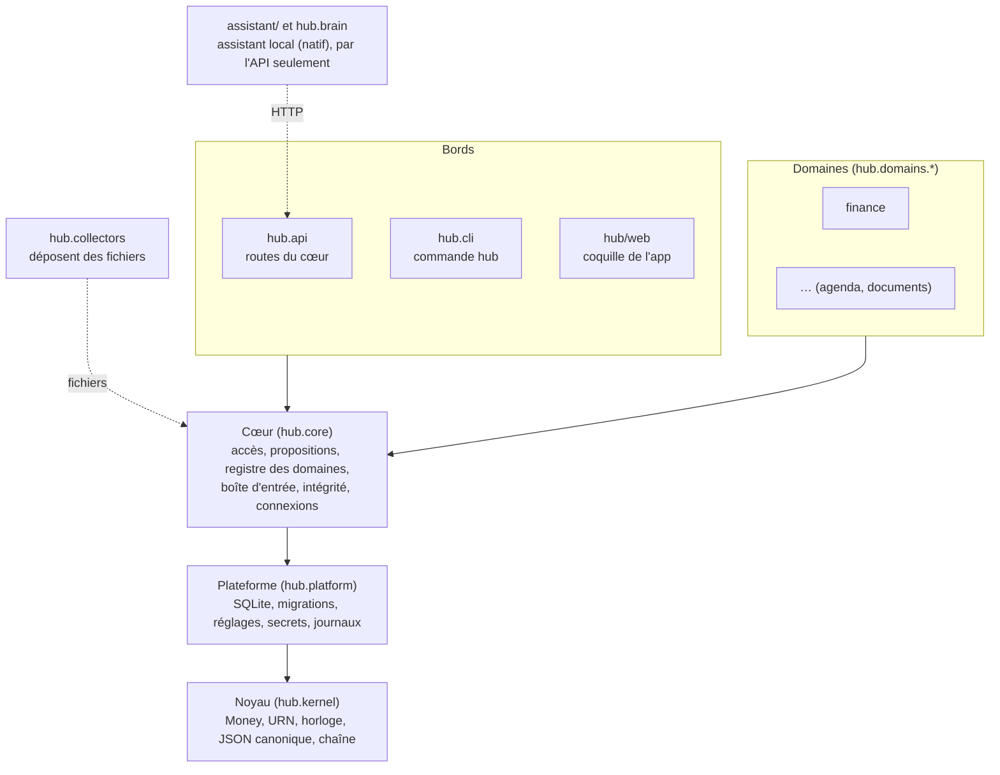
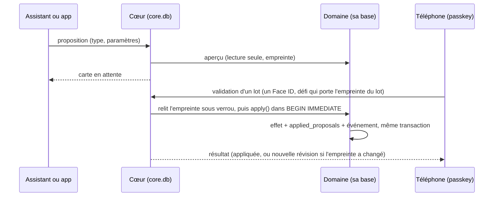
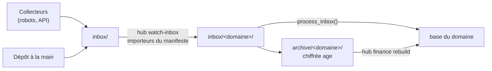
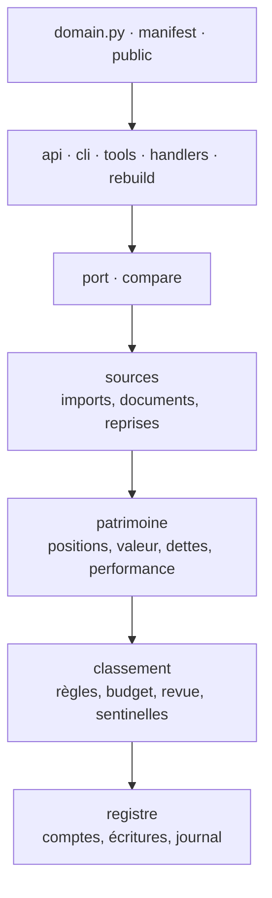

# Architecture

Le hub est un seul processus Python (FastAPI, un worker) devant des bases SQLite, une par
domaine plus `core.db`. Autour : une app web installable (PWA), des collecteurs qui déposent
des fichiers, un assistant local sur le Mac. Les mots sont ceux du [glossaire](glossaire.md),
les choix datés dans [decisions.md](decisions.md).

## Les anneaux

Les flèches sont des imports permis ; import-linter refuse les autres (`pyproject.toml`) :

- un anneau n'importe que ceux d'en dessous ; le noyau n'importe rien du hub, ni base ni
  réseau ;
- ni l'API ni la CLI du cœur n'importent un domaine : elles passent par le registre
  (`hub.core.registry`), alimenté par le point d'entrée `hub.domains` et filtré par
  `HUB_DOMAINS` ;
- les domaines sont indépendants entre eux ; une lecture croisée passe par `public.py` ;
- les collecteurs ne voient ni domaine ni API, le brain ne voit le hub que par HTTP.

Les fichiers tiennent en 400 lignes (`tests/test_file_size.py`) ; les listes d'écarts des
contrats et des tailles ne peuvent que rétrécir.

## Le contrat de domaine

Un domaine remplit `hub.core.domain.Domain` et déclare un manifeste
(`hub.core.manifest.Manifest`). Le cœur, l'app et l'assistant lisent le manifeste au lieu de
connaître le domaine : onglets, blocs d'accueil, rubriques, fichiers réclamés, connecteurs,
tables protégées, consignes. La recette : [ajouter-un-domaine.md](ajouter-un-domaine.md).

## Le Double Sas : une écriture passe par une proposition

Ce qui fait foi est `applied_proposals`, écrite par le domaine avec l'effet ; le statut de
`core.db` n'en est qu'un reflet, que `hub reconcile` rattrape. Certains types ont un palier
automatique (`auto`, `auto_digest`) ; un outil de l'assistant ne crée jamais qu'une carte.

## Les fichiers : collecteurs, boîte d'entrée, archive

Un fichier que personne ne réclame reste à la racine. L'original part chiffré dans l'archive :
une base se reconstruit par rejeu (`hub finance rebuild`) et se compare à l'originale
(`hub finance compare`).

## Recherche, liens, constats

- **Recherche** (`/api/search`) : chaque domaine lisible classe ses résultats ; le cœur les
  fusionne par rang (`hub.core.search`), si bien qu'aucun domaine ne prend toute la page.
  Chaque résultat dit son domaine, son rang et le passage trouvé.
- **Liens** (`/api/links`) : une relation entre deux URN, dans `core.db`. Elle se crée par une
  carte `core/link` (le cœur est propriétaire de ce type, `hub.core.links`) et se défait par
  son inverse.
- **Constats** (`/api/observations`) : ce que chaque domaine remarque seul (budget dépassé,
  abonnement en hausse), réunis pour l'accueil et l'assistant.

## Intégrité

Chaque domaine tient un journal chaîné (`hub.core.integrity`, `hub.kernel.chain`) : une ligne
protégée a son empreinte versionnée, chaque maillon porte la précédente. `hub verify` rejoue
chaîne et empreintes, et contrôle les triggers d'ajout seul.

## La finance, en sous-contextes

Chaque sous-contexte est en couches `interface` → `app` → `infra` → `model` ; le détail est
dans [hub/domains/finance/README.md](../hub/domains/finance/README.md) et
[D-019](decisions.md).

## L'app

`hub/web/` est une PWA sans framework ni script en ligne (CSP stricte). `shell.js` (navigation,
onglets, feuilles) et `sources.js` (réglages) ne nomment aucun domaine : ils lisent
`/api/domains` et chargent les modules du manifeste ([D-018](decisions.md)).

## Ce qui tourne

Sur le Mac (phase 1), en conteneurs (`deploy/compose.yaml`) : `api`, `web` (Caddy : fichiers
de l'app, CSP, proxy `/api`), `tailscale`, `importer` (`hub watch-inbox`), `scheduler`
(crontab), `litestream` et deux collecteurs (`collector-browser`, `collector-api`). En natif,
lancés par launchd : l'assistant (`assistant/`, voix, maison, outils du hub, classement du
matin), qui joint le hub par Tailscale, et le modèle local (Ollama). Voir
[exploitation/](exploitation/README.md) et [brain.md](brain.md).
